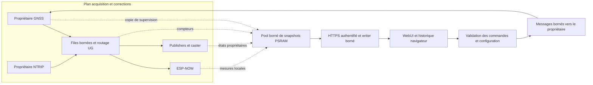

# ESP32-S3 : mémoire et télémétrie — étude du 15 novembre 2026

## Décision proposée

**GO pour une optimisation progressive du backend ESP32, après validation de la
stratégie. Aucune refonte du moteur partagé, réduction de seuil, modification de
NVS ou de partitionnement n’est nécessaire pour commencer.** La télémétrie
complète exige aussi des projections natives encore absentes : libérer de la
mémoire ne suffit pas à rendre tous les diagnostics disponibles.

La priorité recommandée est : instrumentation ciblée, placement explicite des
données de supervision en PSRAM, sérialisation bornée et actualisation Web à la
demande, puis placement des buffers RTCM après qualification de leurs accès.
Les changements de représentation du moteur commun restent un lot séparé.

Cette étude ne modifie aucun firmware et ne valide aucune optimisation A/B sur
la carte. Les gains ci-dessous sont des tailles vérifiées ou des estimations
explicites, jamais des octets prétendument déjà récupérés.

## Référence et méthode

- Dépôt propre au début de l’étude, branche `feat/esp32-alpha-webflasher-pages`,
  commit `c66402248a344adf4490d9a797c7dcd9ae29c5a1` de la PR #36.
- Waveshare S3 W5500, Flash 16 Mio, PSRAM octale 8 Mio, IDF 6.1 épinglé dans
  [dependencies.json](../../embedded/esp32/migration/dependencies.json).
- ELF/map conservés du build reproductible déjà qualifié. Application SHA256
  `7d9e0edb6d693a69d974bda75e6ba6d154ce95ec771f5a761778897c880f8ddc`, identique
  au bundle du commit et à l’image du [premier essai S3](../../embedded/esp32/HARDWARE_ALPHA.md).
- `esp_idf_size`, `xtensa-esp-elf-size`, `nm`, `objdump` et lecture DWARF avec
  pyelftools dans le SDK épinglé : tailles et placement réellement liés, pas des
  `sizeof` x86 attribués à tort au S3. Le conteneur d’analyse n’a ni réseau,
  périphérique, privilège, ni montage de sources ; utilisateur normal UID 1000.
- Requêtes **GET uniquement** sur le S3 existant, certificat local vérifié.
  Aucun accès série, reset, flash, changement de configuration ou écriture NVS.
- Banc synthétique cJSON isolé sur hôte avec les sources de la dépendance
  épinglée : recensement des allocations, normalisé avec la taille de nœud
  Xtensa issue du DWARF. Ce banc ne mesure ni le tas physique ni le CPU du S3.

Les traces détaillées de mesure restent dans un checkpoint local ignoré. Aucun
identifiant de carte, adresse réseau, secret, sauvegarde Flash ou configuration
privée n’est reproduit ici. Aucun résultat de réception GNSS n’est inventé.

## 1. Cartographie vérifiée

### Données statiques et buffers

Le lien réserve **115 600 octets de `.dram0.bss`**, **23 677 de `.dram0.data`**
et **3 de `.noinit`**, soit **139 280 octets de données statiques internes**.
Les instructions/vecteurs en IRAM constituent un autre poste. Les sections
`dummy`, les adresses virtuelles PSRAM et les informations de debug ne sont pas
des consommations de tas à additionner à ces nombres.

| Objet réellement lié | Octets | Placement / remarque |
|---|---:|---|
| `receiver` | 19 576 | RAM interne ; comprend `SatelliteReports` ci-dessous |
| dont `SatelliteReports` | 11 856 | Deux rapports vendor, un NMEA terminé, huit cycles GSV partiels ; inclus dans `receiver` |
| `gateway` | 17 608 | Interne ; dont 16 896 octets pour 8 sorties × 2 trames |
| `publishers[5]` | 11 020 | Interne ; dont 10 560 octets de payload des cinq files |
| `caster_box` | 2 204 | Interne ; dont 2 112 octets de payload |
| `ingress_memory` | 8 512 | Interne ; 8 messages de 1 064 octets |
| FIFO radio `s_queue` | 8 328 | Interne, réservé même radio désactivée |
| Deux codecs radio `s_stream` / `s_radio` | 4 432 | Interne, 2 × 2 216 octets |
| Ligne de maintenance USB | 8 224 | Interne ; budget de commande/provisionnement, pas un buffer RTCM |
| Snapshot satellites publié | 1 080 | Interne, distinct des caches du récepteur |
| Snapshot historique commandes | 928 | Interne, borné |
| Historique NTRIP / événements services | 808 / 800 | Interne, borné |
| Snapshot GNSS commun | 248 | Interne ; coût faible, à préserver en double précision pour la position |

Les sous-objets indiqués ne doivent pas être comptés deux fois. Sources :
[récepteur](../../embedded/esp32/components/ug_receiver_runtime/include/ug_receiver_runtime.hpp),
[satellites](../../embedded/esp32/components/ug_receiver_runtime/include/ug_satellite_reports.hpp),
[routage](../../embedded/esp32/components/ug_gateway/include/ug_gateway.hpp),
[files natives](../../embedded/esp32/components/ug_services/src/ug_network_services.cpp),
[ingress](../../embedded/esp32/components/ug_gateway_service/src/ug_gateway_service.cpp),
[radio](../../embedded/esp32/components/espnow_rtcm/src/espnow_rtcm.c).

Les assets Web compressés occupent **15 611 octets en Flash**, servis directement
depuis leurs données liées. Réduire leur HTML/JS ne libérerait pas ces 15 Kio en
RAM interne. Le bundle de certificats, lui aussi en Flash, ne doit pas être
classé en RAM sur la seule lettre `D` affichée par `nm`.

### Piles, allocations conditionnelles et copies

| Tâche | Pile réservée | Minimum libre observé pendant cette étude |
|---|---:|---:|
| Routage RTCM | 6 144 | 5 240 |
| NTRIP entrant | 10 240 | 5 320 |
| Cinq publishers | 40 960 au total | 4 084 à 4 112 par tâche |
| Caster | 8 192 | 5 200 |
| Propriétaire GNSS | 16 384 | 7 292 |
| Console locale | 16 384 | Non exposé actuellement |
| HTTPS | 24 576 | Non exposé actuellement |
| **Total applicatif permanent créé au démarrage** | **122 880 = 120 Kio** | Hors TCB et tâches SDK |

Les minima sont ceux rapportés par `WorkerHealth` après les opérations déjà
effectuées ; ils ne couvrent pas un GNSS actif ou des connexions NTRIP réelles.
Une tâche publisher utilise déjà environ 4 Kio de pile dans cette référence :
passer arbitrairement sa pile de 8 à 4 Kio serait dangereux.

Le démarrage dispose de 32 Kio **libérés au retour de `app_main`**. Sa marge
de 19 304 octets vient de la campagne précédente, sans nouveau reset ici.
Réduire cette pile ne gagne rien sur le budget permanent de la WebUI.
Radio activée, deux piles supplémentaires demandent 4 096 et 3 072 octets ;
l’allocation du Wi-Fi et les ressources associées s’ajoutent à ces piles.

`xTaskCreate` utilise les capacités internes du port FreeRTOS IDF. HTTPS conserve
également ses `task_caps` internes par défaut. La possibilité de créer certaines
piles externes ne prouve pas leur sécurité : console/configuration/TLS peuvent
appeler du code ROM ou des opérations Flash. Ce n’est pas une première mesure.

Autres postes :

- TLS : allocation externe déjà sélectionnée ; tailles de contenu configurées
  **16 384 RX + 4 096 TX**, buffers dynamiques désactivés. Les contextes,
  certificats et négociations ajoutent leur propre coût. Il faut budgéter chaque
  session HTTPS et NTRIP, pas une seule instance globale.
- TCP : fenêtres et buffers d’émission configurés à **5 760 octets** ; ce sont
  des limites/configurations, pas autant de mémoire systématiquement préallouée
  pour chacun des 20 sockets autorisés.
- W5500 : le pilote crée une pile RX de **4 096 octets**, demande un buffer de
  **1 522 octets avec `MALLOC_CAP_DMA`**, et alloue/copie des paquets selon le
  trafic. Les **16 Kio RX et 16 Kio TX du W5500** appartiennent au contrôleur
  externe, pas au tas ESP32. Le mode utilisé reste MACRAW avec lwIP sur l’ESP32.
- GNSS UART activé : buffers demandés **4 096 RX + 1 024 TX**, plus 32 événements
  et les structures du pilote. Ces allocations ne sont pas actives ici.
- Caster : limite configurée à quatre clients, chacun borné à 4 096 octets
  **non envoyés**. `std::vector` peut conserver une capacité et un préfixe déjà
  consommé ; 4 × 4 096 n’est donc pas une preuve d’un plafond réel de tas de 16 Kio.
- `Settings` vaut **2 016 octets**, hors stockage dynamique des chaînes.
  Les snapshots immuables peuvent rester référencés par des workers pendant une
  connexion ; `shared_ptr` évite une copie complète à chaque lecture mais ne
  supprime pas le coût de coexistence de plusieurs révisions.
- `SettingsStore::Load` a un cadre de pile compilé de **6 144 octets** ;
  `StartConfiguration` en ajoute 2 112 et les appels imbriqués davantage.
  `Previous` en demande 4 112, `DecodeSettings` 2 224. Ces tailles de cadres
  expliquent le risque ; elles ne sont pas des maxima de chaîne d’appels.
- `Receiver::ConfigureTelemetry` construit une session temporaire : cadre de
  **4 800 octets**. Les sessions stockent actuellement un timestamp optionnel
  par octet : `BufferedByte` vaut **24 octets**. Un tampon d’autodétection de
  4 096 octets de données représente donc **98 304 octets de payload de vector**,
  avant capacité supplémentaire et transitoires. Le natif ajoute au plus un lot
  de 512 octets avant sélection/trim ; ces coûts n’ont pas été observés avec GNSS
  désactivé. Les plafonds des protocoles ne sont pas des plafonds de tas global.
- NTRIP entrant : le wrapper possède un buffer fixe de 512 octets, mais
  `NtripClient::Read` alloue encore un vector temporaire de la capacité demandée
  avant de recopier les octets. Les headers de réponse ont un budget de 8 Kio et
  peuvent coexister dans plusieurs chaînes ; les frames observées possèdent leurs
  propres payloads. Le publisher natif utilise, lui, une réponse fixe de 1 024
  octets. Ces transitoires ne sont pas actifs dans le relevé NTRIP désactivé.

Les capacités des vectors peuvent rester réservées après `clear()` ou `Reset()`.
Par exemple, la limite binaire Unicore configurée à 65 536 octets ne signifie pas
un coût de 64 Kio avec une représentation à 24 octets par octet reçu. Toute
optimisation commune devra préserver exactement les timestamps des lots, les
valeurs absentes et les frontières de réponse ; la remplacer par un timestamp
unique arbitraire modifierait le contrat.

## 2. Mesures sur la carte existante

Séquence débutée le **15 novembre 2026 à 11:03:07, heure de Paris** : 42 réponses
chronométrées, plus les requêtes de contexte et de contrôle. Uptime initial
2 398 secondes ; Ethernet actif, GNSS, NTRIP entrant, cinq publishers, caster,
STA/AP et radio désactivés dans la configuration. Aucun changement de ces états.

| Scénario | RAM interne libre | Plus grand bloc interne | PSRAM libre |
|---|---:|---:|---:|
| 12 relevés, une connexion TLS persistante | 70 655 | 32 768–34 816 | 8 351 632 |
| 6 nouvelles connexions TLS successives | 70 651–70 655 | 34 816 | 8 351 632 |
| 3 clients TLS, 4 requêtes chacun | 69 535–70 195 | 34 816 | 8 295 096–8 323 352 |
| Après la séquence | 70 443 | 34 816 | 8 351 632 |

Total du tas PSRAM déclaré : **8 386 068 octets**. Minimum historique interne :
**21 180 octets**, inchangé sur la séquence. Tous les GET ressources/statut ont
répondu 200. Le GET satellites a répondu **503**, conformément au contrôle
« pression réduite » ; ce contrôle n’a pas été contourné.

Latences hôte observées : GET ressources médian ~51 ms, statut ~78 ms ; connexion
TLS seule ~808–869 ms, jusqu’à ~2 451 ms avec les trois clients concurrents.
Elles incluent hôte, réseau, ordonnanceur et serveur ; **ce ne sont pas des
mesures de latence PSRAM, de charge CPU ou du temps de traitement RTCM**.

Il manque **27 649 octets** au relevé de référence pour atteindre le seuil
inchangé de 96 Kio libres. Le plus grand bloc satisfait déjà 32 Kio sur ces
relevés. L’écart libre/bloc maximal révèle une contrainte de contiguïté ; il ne
prouve pas, à lui seul, une fuite ou une fragmentation croissante : plusieurs
régions de tas et les allocations permanentes interviennent aussi.

Cette courte séquence ne montre pas de décroissance soutenue et revient au même
niveau de PSRAM. Elle ne constitue pas un test d’endurance ni une preuve
d’absence de fuite. Le vrai repos sans aucune session TLS n’est pas mesurable
par une requête HTTPS qui crée justement une session.

Les seuils restent : normal à partir de **96 Kio libres / 32 Kio contigus** ;
critique sous **48 Kio / 16 Kio**. Le minimum historique n’est pas utilisé comme
état courant. Voir le [contrôleur](../../embedded/esp32/components/ug_supervisor/include/ug_resource_policy.hpp).

## 3. HTTPS, allocations JSON et contention

[`Json`](../../embedded/esp32/components/ug_web/src/ug_web.cpp) construit un
arbre cJSON, puis `cJSON_PrintUnformatted` produit une seconde représentation
complète avant l’envoi. Les noms de clés sont également dupliqués.

`cJSON` vaut **40 octets sur Xtensa**. Beaucoup de petits nœuds et chaînes
préfèrent encore l’interne avec `SPIRAM_MALLOC_ALWAYSINTERNAL=1024`. Déporter
TLS ne déporte donc pas automatiquement le graphe JSON. Le compteur global de
mémoire libre mélangeant PSRAM et interne ne doit pas gouverner l’admission Web.

Banc synthétique du schéma SATSINFO avec tous les champs disponibles :

| Satellites | Nœuds | Allocations pendant construction/impression | JSON produit | DOM demandé, normalisé Xtensa | Pic total demandé, normalisé |
|---|---:|---:|---:|---:|---:|
| 0 | 14 | 32 | 280 | 763 | 1 570 |
| 16 | 142 | 274 | 2 014 | 7 067 | 11 232 |
| 64 | 526 | 996 | 7 246 | 25 979 | 41 836 |

Ce sont des **allocations demandées par le banc hôte**, avec correction
64 → 40 octets par nœud, hors surcoût de l’allocateur ESP32. Le pic total comprend
des buffers d’impression qui peuvent aller en PSRAM ; il ne faut pas le présenter
comme 41 836 octets de RAM interne réellement mesurés. Les 25 979 octets du DOM
montrent néanmoins l’ordre de grandeur du problème et la multiplication des
petites allocations. Des valeurs/présences différentes changent les résultats.

La WebUI fait actuellement un polling toutes les trois secondes, sans adaptation
à `document.visibilityState`. Elle évite les refresh concurrents et réduit déjà
le travail sous pression. Les historiques NTRIP/commandes/événements sont
consultés à la demande : **c’est déjà présent**, pas un gain nouveau à promettre.

Les snapshots sont copiés sous mutex, puis sérialisés après libération : cette
séparation utile doit être conservée. Le propriétaire GNSS recopie néanmoins
état et rapports à chaque tour, même sans nouvelle observation. Les optimisations
doivent porter sur la publication par changement/observation, sans transformer
une republication en observation physique fraîche.

HTTPS est de priorité 2 : inférieur au routage 5 et au GNSS/radio 4, mais de même
priorité que publishers/caster. Il existe donc encore une concurrence de CPU et
de tas. Un envoi HTTP lent ne doit jamais garder un verrou de l’acquisition ou
du routage. Le streaming borne la mémoire, **pas automatiquement le temps d’envoi**.

IDF fournit [`httpd_resp_send_chunk`](https://docs.espressif.com/projects/esp-idf/en/v6.1/esp32s3/api-reference/protocols/esp_http_server.html#_CPPv421httpd_resp_send_chunkP11httpd_req_tPKc7ssize_t)
pour l’envoi progressif. Un writer JSON de taille fixe doit encore vérifier chaque
retour, borner le nombre d’éléments et la durée totale, gérer échappement et nombres
finis, puis terminer la réponse. Des données non fiables ne doivent jamais être
injectées directement dans du JSON.

## 4. Politique mémoire cible

**Interne** : TCB, verrous et métadonnées de contrôle, piles non qualifiées pour
la PSRAM, ISR/IRAM, descripteurs et buffers exigés par SPI/DMA, petite réserve
de contrôle/diagnostic de secours. Le W5500 garde son contrat DMA.

**PSRAM explicite et bornée** : rapports satellites et RF, historiques volumineux,
payloads de supervision, ligne de maintenance, buffers de sérialisation ; puis
payloads des files RTCM après vérification des propriétaires et accès.

L’allocation de ces blocs doit se faire au démarrage du sous-système avec
capacités explicites et échec géré. Une simple préférence `malloc` autorise une
retombée en interne ; ce n’est pas une réservation. Éviter une bascule globale
de tous les petits `malloc` et tout déplacement aveugle de structures contenant
mutex, éléments SDK ou objets utilisés pendant une indisponibilité du cache.

L’[IDF 6.1 documente les contraintes PSRAM](https://docs.espressif.com/projects/esp-idf/en/v6.1/esp32s3/api-guides/external-ram.html) :
accès dépendant du cache, partage de ressources avec la Flash, restrictions pour
les piles et besoins spécifiques du DMA. Le S3 possède des possibilités EDMA,
mais cela ne dispense pas de respecter le pilote SPI/W5500 et ses capacités.
L’accès à de grandes données peut évincer le cache et créer de la contention.
**Aucune bande passante ni pénalité PSRAM n’a été mesurée ici.**

Premier ensemble de supervision à examiner : cache satellites + snapshot
**12 936 octets**, ligne de maintenance **8 224**, soit **21 160 octets de
payload interne candidats**. Il ne suffit pas seul à combler les 27 649 octets
manquants. Les payloads ingress + huit sorties + six outboxes représentent
ensuite **38 080 octets** supplémentaires candidats. Ce sont des tailles à
relocaliser, pas une garantie de gain net ou de contiguïté après intégration.

`cJSON_InitHooks` est global. Changer ses hooks temporairement par requête serait
incorrect pendant des opérations JSON concurrentes de configuration. Comparer
un writer sans DOM à une arène PSRAM à ownership explicite ; toute solution
cJSON conserve des hooks stables et des règles de libération cohérentes.

## 5. Disponibilité réelle de la télémétrie

| Domaine demandé | Disponible actuellement | Travail nécessaire pour l’interface complète |
|---|---|---|
| Position, FIX/RTK, précision, DOP | Modèle UG et projection native partielle existants | Présentation structurée, disponibilité/fraîcheur par champ ; conserver `double` pour la position |
| Satellites et C/N0 individuel | NAV-SAT, SATSINFO et cycles GSV bornés ; endpoint à 64 entrées | Pagination/snapshot cohérent ; exposition de plusieurs portées constellation/signal |
| C/N0 moyen / maximum | Deux champs dans `GnssRuntimeState` ; maximum absent du JSON natif | Compléter la projection, avec provenance et absence explicite |
| Par fréquence | GSV a une portée signal ; SATSINFO conserve des indicateurs/nombres de fréquences | Ne pas inventer du C/N0 par bande à partir d’un C/N0 agrégé ; NAV-SIG n’a pas de parseur identifié dans ce périmètre |
| Brouillage / interférences | Booléens UG existants, convertisseurs MON-HW/MON-RF/JAMSTATUS/FREQJAMSTATUS | Les exposer ; conserver aussi les détails vendor dans un snapshot natif borné |
| AGC / matériel | Parseurs UBX MON-HW/MON-HW2/MON-RF, Unicore AGC/HWSTATUS présents | Les détails bruts ne sont pas tous retenus par les sessions ni publiés ; ajouter le pont de diagnostics natif, sans dupliquer les parseurs |
| RTCM | Compteurs routage/rejet/stale/drops, métriques NTRIP et statut RTCM receiver existants | Compteurs par source/sortie, occupation/max des files et âge de tête ; distinguer octets entrants, trames valides et livraisons observées |
| NTRIP | État propriétaire, révision/configuration/liaison, compteurs, historique borné | Affichage dédié et incrémental ; capacité et disponibilité distinctes |
| ESP-NOW | File, frames TX, ACK MAC, échecs ; RX/CRC/réassemblage et sortie côté Rover | Afficher ce qui est localement mesuré ; RSSI, séquences/pertes/latences requièrent instrumentation supplémentaire |
| Ethernet / Wi-Fi | Liaison suivie pour les services et configuration effective | Snapshot réseau expurgé : état réel, erreurs/compteurs SDK ; aucune MAC, SSID ou clé exposée publiquement |
| CPU / toutes les tâches / piles | Tas interne/PSRAM et marges de neuf workers UG mesurables | Instrumenter HTTPS/console/SDK et temps CPU ; instrumentation runtime actuellement désactivée |
| Erreurs / événements | Anneaux services/NTRIP/commandes existants | Curseur + incarnation de boot + pertes d’historique ; cache navigateur borné |

Sources : [état commun](../../core/gnss_core/include/universal_gnss/gnss_runtime_state.hpp),
[records UBX](../../protocols/gnss_protocols/include/universal_gnss_protocols/ubx_records.hpp),
[records Unicore](../../protocols/gnss_protocols/include/universal_gnss_protocols/unicore_records.hpp),
[session Unicore](../../core/gnss_driver/src/unicore_session.cpp),
[projection HTTPS](../../embedded/esp32/components/ug_web/src/ug_web.cpp).

Le cache GSV possède huit cycles partiels mais ne conserve qu’un dernier cycle
NMEA terminé. `Latest` préfère un rapport vendor frais. Cela ne constitue pas
déjà un inventaire simultané de toutes les constellations et fréquences.
Il faut conserver les namespaces de systèmes/signaux ; ni fusion arbitraire de
PRN ni rafraîchissement d’un epoch vendor répété.

Ces lacunes sont des **implémentations logicielles restantes**, pas uniquement
des essais bloqués par le GNSS absent. Les tests de réception restent ensuite
matériels. Un ACK ESP-NOW MAC ne prouve pas la réception RTCM USB au Rover ; une
latence bout en bout demande des horloges reliées ou un protocole de mesure.

## 6. Buffers RTCM et architecture des deux plans

Le pipeline est déjà borné : ingress 8 messages, files de routage 2 trames par
sortie, outboxes NTRIP/caster 2 trames, FIFO radio 8 messages. Les producteurs
utilisent un envoi sans attente et comptent des rejets. En saturation, la politique
courante rejette la nouvelle trame, elle ne choisit pas automatiquement la plus
fraîche. Les files ont plusieurs étages et copient les mêmes payloads.

Le routage/outbox vérifie la fraîcheur à **3 secondes** et l’incarnation source ;
la radio applique **1 seconde** et son epoch d’invalidation. Il ne faut ni
renouveler le timestamp à chaque étage ni allonger les files pour masquer une
congestion. Les trames partielles/corrompues et les changements de source gardent
leurs règles de rejet. Un client caster lent reste isolé/déconnecté.

Architecture proposée :

- Un seul propriétaire mutable par donnée. Publier des snapshots immuables,
  versionnés, horodatés en monotone ESP et identifiés par source/incarnation.
  Les réceptions physiques, publications de cache et changements de configuration
  ont des identités distinctes. Les âges restent propres à chaque donnée.
- Pool supervision préalloué : acquisition d’un slot **sans attente**. Si les
  lecteurs retiennent tous les slots, coalescer explicitement les publications
  de supervision et compter les pertes ; ne jamais bloquer les corrections.
  Un double buffer seul ne garantit pas cela si un lecteur garde un slot.
- Aucune sérialisation, allocation variable ou attente réseau dans un verrou
  d’acquisition. Le handler libère son snapshot même après timeout/déconnexion.
- Pages satellites identifiées par snapshot/incarnation/portée ; un curseur ancien
  ne peut assembler deux époques. Pour les deltas, absence de changement ne signifie
  pas nouvelle observation ; après reset/gap, réinitialiser explicitement le cache.
- Actualisation de la vue visible, requêtes regroupées, cadence adaptative et
  arrêt du polling en onglet masqué. Tous les diagnostics restent consultables ;
  ils ne sont pas supprimés pour réduire la charge.
- Historiques navigateur bornés, sans secrets ni stockage persistant automatique
  des positions. Maintenir un petit anneau de sécurité côté firmware pour les
  erreurs précédant l’ouverture du navigateur. Identifier les trous d’historique.
- Les contrôles d’authentification, fenêtres radio, journal/quarantaine GNSS et
  confirmations persistent. Les changements de configuration restent indépendants
  d’une source GNSS physiquement présente.

Les compteurs/identifiants 64 bits doivent conserver leur exactitude dans le
transport JSON et JavaScript, par exemple avec une représentation décimale typée
plutôt qu’une conversion implicite au-delà de 53 bits. Les horloges monotones du
navigateur et de l’ESP32 ne sont pas directement comparables : transmettre des
âges et identités de snapshot, sans les convertir implicitement en UTC.

Un pool de trames RTCM avec handles générationnels pourrait ensuite réduire les
copies entre étages. Il doit libérer les références d’un consommateur lent,
refuser les handles réutilisés et invalider correctement toutes les références
d’une source. C’est une optimisation ultérieure à risque supérieur, pas un
remplacement immédiat du pipeline actuel ni de ses contrôles CRC24Q/CRC16.

## 7. Comparaison des optimisations

Les gains sont des potentiels calculés ou des ordres de grandeur du banc,
**pas des gains nets mesurés après flash**. Ils ne sont pas tous cumulables.

| Proposition | Gain attendu / base vérifiée | Difficulté | Risque / impact |
|---|---|---|---|
| Vue visible + cadence adaptative | Réduit les requêtes des onglets masqués ; peu de gain sur le coût fixe | Faible | Faible ; conserver indicateurs d’âge et arrêt après logout |
| PSRAM supervision + ligne USB | 21 160 octets de payload candidats | Faible à moyenne | Cache Flash, allocation et effacement des secrets à vérifier ; aucun diagnostic retiré |
| Writer JSON progressif, buffer 512–1 024 octets | Évite le DOM et sa duplication ; banc 64 SV : DOM demandé 25 979 octets | Moyenne | Échappement, précision, réponse interrompue et timeout global |
| Pagination 16 SV | Banc : DOM 7 067 contre 25 979 ; JSON 2 014 contre 7 246 | Moyenne | Cohérence des pages et conservation de l’ensemble des 64 entrées |
| Snapshots légers publiés sur observation/changement | Réduit les recopies et verrouillages périodiques ; état commun seulement 248 octets | Moyenne | Invalidation et fraîcheur ; pas une raison de réduire la précision |
| API delta + historique navigateur | Réduit réseau/JSON inchangé, selon activité réelle | Moyenne | Curseurs expirés, reboot et trous ; aucune fraîcheur artificielle |
| Payloads RTCM en PSRAM explicite | 38 080 octets ingress/routage/outboxes candidats ; radio séparée | Moyenne | Latence/cache/sections critiques ; ne pas déplacer le DMA ni les contrôles |
| Workers optionnels à la demande | Jusqu’à 40 960 octets de piles publishers inutilisés, selon lifecycle | Moyenne à élevée | Gain nul si tous actifs ; arrêt propre, NVS/config disponible et reprise à concevoir |
| Réduire les copies de validation Settings | `Settings` 2 016, pile `Load` 6 144 ; limite des transitoires | Moyenne | Validation unique atomique sous révision/verrou ; préserver banks, secrets et contrôle radio |
| TLS buffers dynamiques | Baisse possible de PSRAM inactive par session ; faible réponse au problème interne | Moyenne | Plus d’allocations, latence et conditions de reconnexion à qualifier |
| Pool RTCM à handles | Réduit des copies et éventuellement le stockage dupliqué | Élevée | Références lentes, ABA, ordre, incarnation et congestion ; différer |
| Buffer octets + segments de timestamps dans UG | Évite le facteur 24 par octet sur certains tampons | Élevée | Contrat de réception/fence/ABI et tous backends ; étude séparée |

Fusionner tous les publishers dans une seule tâche pourrait économiser des
piles, mais leurs opérations réseau bornées restent potentiellement bloquantes :
cela introduirait un couplage entre sorties. Ce n’est pas une modification
minimale recommandée. Déplacer toutes les piles en PSRAM, réduire les seuils ou
désactiver les diagnostics sont également écartés comme premières solutions.

## 8. Plan progressif et acceptation

1. **Observabilité minimale avant optimisation.** Relever séparément interne,
   DMA et PSRAM : libre, minimum, bloc maximal, nombres de blocs, échecs
   d’allocation. Ajouter identifiant d’image, phases TLS/API et minima de pile
   HTTPS/console/SDK ; occupation/maximum/âge des files par propriétaire. Mesurer
   le coût de l’instrumentation. Aucun secret ni payload brut dans les traces.
2. **Placement PSRAM de supervision, puis buffers sélectionnés.** Allouer une
   fois, garder les structures de contrôle internes, gérer l’échec avant
   activation. Comparer octets et plus grand bloc à baseline identique. Critères :
   aucun changement de trame/configuration, aucun nouvel overflow/watchdog,
   aucun fallback interne silencieux ni blocage de l’acquisition.
3. **API bornée et WebUI adaptative.** Writer JSON exact, pages/snapshots stables,
   détection de page périmée, authentification et admission inchangées.
   Tests 0/16/64 entrées, valeurs limites/non finies, Unicode/échappement,
   faute d’allocation, client lent/déconnecté, trois clients, logout concurrent,
   import/export et réglages sans matériel. Mesurer le pic interne et le nombre
   d’allocations ; ne pas accepter une réduction du seul JSON réseau comme gain RAM.
4. **Projection de toute la télémétrie réellement décodable.** Ajouter maximum
   C/N0, brouillage, raw RF/AGC/matériel et statistiques réseau/files par snapshots
   natifs. Rejouer les fixtures UG existantes et tester source absente, donnée
   périmée, même valeur observée deux fois, epoch répété, changement de modèle,
   incarnation et reset. Les données non disponibles restent explicitement telles.
   Les parseurs/formats manquants constituent des travaux distincts.
5. **Qualification combinée S3 après autorisation de firmware de mesure.** GNSS
   réel ou replay contrôlé, Ethernet, NTRIP, publishers/caster, ESP-NOW et trois
   clients HTTPS. Mesurer sans/sous télémétrie : débit, drops, âges/latences locales,
   marges de pile, bloc maximal et échecs d’allocation. Refaire avec panne réseau,
   consommateur lent et reconnexion. Les seuils 96/32 et 48/16 Kio restent identiques.
   Critère : tous les diagnostics disponibles restent consultables, avec budget
   borné, sans régression des corrections ; préciser l’enveloppe de charge acceptée.
6. **Optimisations plus profondes seulement si le profilage le justifie.** Lifecycle
   des workers, pool de trames ou représentation commune des timestamps : PR
   séparées, compatibilité Linux/ROS2 et frontières de distribution vérifiées.
   Aucun besoin de Rust ni de réécriture des services pour les premiers gains.

Les seuils sont un minimum d’admission, pas une preuve de réserve suffisante pour
toutes les négociations et pointes. La stratégie finale doit maintenir une marge
mesurée pendant les cas combinés, pas seulement à l’ouverture de la WebUI.

## Mesures encore nécessaires

Le firmware courant a `HEAP_TRACING_OFF`, pas de hooks d’allocation ni de
statistiques CPU FreeRTOS. On ne peut donc pas extraire rétroactivement une trace
complète des allocations/piles sans instrumentation. Les outils
[IDF heap tracing, failed-allocation hooks et heap information](https://docs.espressif.com/projects/esp-idf/en/v6.1/esp32s3/api-reference/system/heap_debug.html)
sont adaptés à une future image de diagnostic explicitement autorisée ; leur
surcoût doit être mesuré et la trace courte/bornée. Le calcul du bloc maximal
doit être séparé du minimum historique. Aucun flash n’est fait pour cette étude.

Restent inconnus : repos réellement sans TLS, pic intra-handshake et intra-JSON,
minima HTTPS/console et toutes tâches SDK, placement exact des allocations
dynamiques par propriétaire, CPU et temps de section critique, latence/cache
PSRAM sous contention, budget avec GNSS/radio/NTRIP/caster actifs et endurance.
L’absence du récepteur n’empêche pas les essais logiciels de schéma/snapshot ;
elle empêche de qualifier ses valeurs RF/GNSS physiques.

## État de livraison

Rapport d’étude uniquement. Aucun code, configuration, workflow, version,
partitionnement ou NVS modifié ; aucun commit, push, merge, flash ou publication.
Les tests fonctionnels déjà acquis de la PR #36 n’ont pas été relancés : ils ne
constituent pas une nouvelle validation de cette étude. Seuls l’analyse du build,
les GET de mesure et le banc d’allocations décrits ci-dessus ont été exécutés.
Les métriques d’avancement TODO/ROADMAP et les preuves historiques restent
inchangées : aucune fonctionnalité supplémentaire n’a été implémentée.
