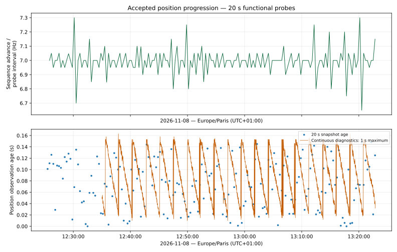
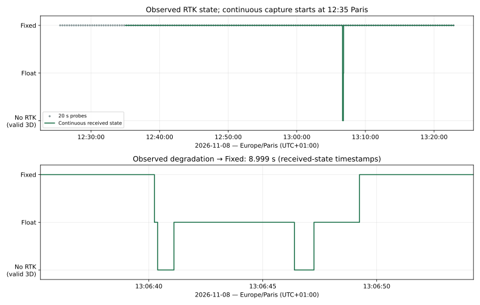
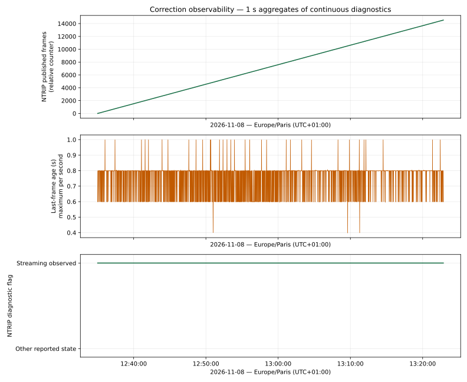
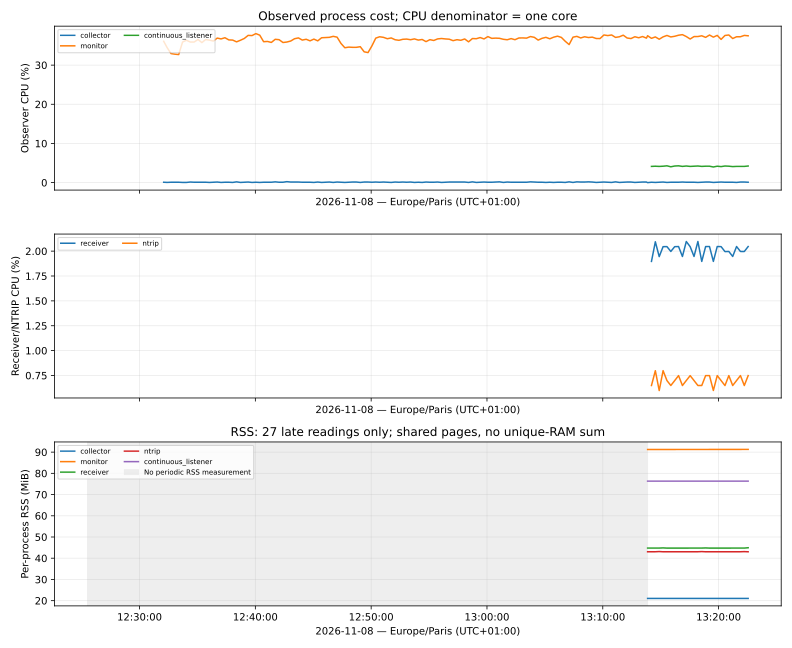

# rc6 passive mower campaign — 2026-11-08

## Result and scope

**Functional observation result: PASS within the recorded baseline and window.**
The receiver position sequence and receiver epochs progressed, corrections
remained live, and the observed natural RTK degradation recovered. No fix-invalid
publication, receiver-epoch regression, malformed/rejected receiver record,
source-incarnation change or production process/container restart was observed.
This is a bounded functional observation, not universal hardware qualification.

User-facing times below use **Europe/Paris (UTC+01:00)**. Machine evidence uses
UTC and explicitly recorded monotonic receipt clocks.

| Evidence stream | Observed window, Paris | Coverage |
| --- | --- | --- |
| Functional collector | 12:25:30.282–13:22:50.336 | 173 samples; 57 min 20 s between first/last sample; 12 support snapshots |
| Correlation timeline | 12:25:59.787–13:22:52.787 | 3,414 samples at approximately 1 Hz; clean final summary |
| Continuous GNSS/diagnostics | 12:35:01.533–13:22:52.819 | 20,100 status publications over 47 min 51 s |

Telemetry first reported MOWING at 12:29:49.788. At the operator's stop, it
reported IDLE at 13:22:28.785 and RETURNING_HOME at 13:22:40.791. Collection ended
at 13:22:52.845; completed docking and subsequent charging are outside this run.
The entire window is not continuous blade-on time: operator interventions and
navigation pauses are recorded separately.

## Exact baseline

- Development MowgliNext: dev `78104cf8cee835fe1acc948f7611379ac1fce124`.
- Universal GNSS submodule HEAD and parent gitlink:
  `d02e23f17d34e58f75f4c7a7f72f8d34ea766bfa`, tag `v0.7.4-rc6`.
- Robot: `Peuchmower2`, operator-described Raspberry Pi 5 and u-blox F9P at 921600
  baud; Debian 13, aarch64, kernel `6.18.50+rpt-rpi-2712` observed passively.
  Exact receiver firmware and driver revision were not independently acquired;
  the occupied serial port was never opened by the observers.
- GNSS image:
  `ghcr.io/pepeuch/universal-gnss-ros2-lyrical@sha256:eafa78d1d28da22059be8d88f12e8c742eabb3008aede1f6f031c49b3da0ed7c`.
  OCI version/revision match rc6/d02e23f; architecture arm64; runtime user 1000:1000.
- Container `mowgli-gps`:
  `785c33b4135852b4b11033435c16e34bb7d1c99d11a2d0f13e20629e0226633e`.
  Receiver PID 1764, NTRIP PID 1765, RestartCount 0 before and after.
- Source ID:
  `/dev/serial/by-id/usb-u-blox_AG_-_www.u-blox.com_u-blox_GNSS_receiver-if00`,
  resolving to `/dev/ttyACM1` during inventory.
- Source incarnation: `c84731b579b241d489248f339218b5b1` throughout.
- Robot host checkout: `5d3845b14c175ff3367c11e24f8f6f0dd7f0da51`.
  Actual ROS image revision `4978cb72f96dbd19c538393d9cccd6b5c5b6099d`, digest
  `sha256:2d0b5ee27d146ec16a50918edf111b3ede5923c27f4ef7aec66b1bc801ac20ad`.
  These differ from the development checkout and are not interchangeable.

Configuration values and NTRIP credentials are excluded; the collector records
only the parameter-file identity/hash. The accompanying metrics retain the
exact identities. Evidence does not transfer automatically to another receiver,
firmware, gitlink, image, driver/kernel, robot unit or physical arrangement.

## Acquisition and interpretation

The installed September helper differed from official rc6 only in its service
import. Five official scripts were copied from the pinned revision to
`/home/pepeuch/universal-gnss-validation/versions/d02e23f/`; the previous tools
were preserved. Official helper SHA256:
`f5711ba65c0b5c7dbca8b742dd6a752db37ca481f2b9ed46fe0622794d638f42`.

The functional mode explicitly selected the production container, digest, source
revision, stable by-id and parameter hash, with 20s samples and 300s support
snapshots. All 173 snapshot probes succeeded. Collection intervals were
19.9995–20.0100s. Approximately 92GiB was free at preflight.

A separate 1Hz Mowgli correlation monitor and a continuous GNSS/diagnostics
subscriber ran as user 1000. They issued no robot commands, receiver writes or
persistent configuration. The latter subscribed to status and diagnostics only.
Its GNSS QoS was best-effort/depth100: this is observed DDS delivery, not a
lossless serial capture, and it starts after mowing began. Raw serial framing,
receiver persistent state and physical positioning error were not measured.

`GnssStatus.stamp` is the ROS-clock receipt of the latest accepted runtime-field
update, including non-position updates. Position identity is the combination of
source ID, incarnation and position sequence. Receiver epoch and position age
were taken separately from canonical diagnostics; callback arrival was never
credited as a new physical observation. Monotonic receipt intervals were used
for rate/resource calculations. Numerically identical coordinates alone are
not proof of stale data, especially during pauses.

The official helper's fix-name table omits 6/7/8. Raw 7 was interpreted using the
rc6 message schema as 3D_FIX, independently of RTK mode3 (FIXED). The mechanical
summary's sequence max-minus-min is valid here only because one source
incarnation was observed; it must not be reused across an identity change.
The live collector is not modified by this documentation candidate. Its fix-name
map and cross-incarnation sequence-summary limitations remain tool-maintenance
follow-ups, recorded in the shared review; plots use the independently verified
raw values and reject unsegmented identity changes.

## Position, transport and parsing results

| Metric | Result |
| --- | --- |
| Functional position sequence | 607470→631531: +24,061 over 3,440.054s, approximately 6.994Hz |
| Continuous publications | 20,100; first publication establishes the baseline |
| Publications advancing the position sequence | 19,561; summed sequence advance 20,079 |
| Same position sequence and same runtime receipt stamp | 342 |
| Same position sequence with advanced runtime receipt stamp | 196; not new positions |
| Same-position-sequence total | 538; excluded from new-position counts |
| Advances larger than one | 518, accounting for accepted observations between output publications; not attributed to DDS loss by assumption |
| Observed publication interval | median 0.142856s; p95 0.144350s; max0.159567s |
| Invalid-fix publications / sequence regressions | 0 / 0 |
| Position observation age, canonical diagnostic | median 0.070s; p95 0.136s; max0.163s |
| Transport RX age, canonical diagnostic | max0.163s |
| Receiver epoch regression counter | 0 throughout |
| Malformed / rejected / parser-anomaly totals | 0 throughout the continuous capture |
| Warning/error diagnostic records | 0 in the continuously recorded GNSS/NTRIP diagnostics |

The 342 same-sequence/same-stamp records are not asserted to be bitwise-identical
complete ROS messages: the capture retained selected fields. All 538 publications
without a position-sequence advance remain non-new position observations.

## Natural RTK degradation and recovery

The continuous subscriber captured a short event which20s snapshots alone can
miss. The operator later reported lifting the mower to remove debris from a
front wheel. That retrospective report supplies intervention context; it does
not independently measure the exact physical action time or prove a particular
RF/antenna mechanism.

| Paris time | Observed RTK mode |
| --- | --- |
| Before 13:06:40.246 | Fixed |
| 13:06:40.246 | Float |
| 13:06:40.389 | None (3D fix remained valid) |
| 13:06:41.103 | Float |
| 13:06:46.389 | None (3D fix remained valid) |
| 13:06:47.247 | Float |
| 13:06:49.245 | Fixed |

Recovery from the first degradation to Fixed took approximately 8.999s. Over the
continuous capture, previous-publication state attribution gives approximately
2,862.286s Fixed, 7.427s Float and 1.573s without RTK; these are sampled state
durations, not independently instrumented receiver switch times.

All captured publications remained fix_valid=true and 3D_FIX. During the examined
13:06:30–13:07:00 interval, sequence 624661→624877, one source incarnation,
advancing receiver epochs and zero regression counter were observed. NTRIP
remained streaming; forwarded-frame count 469319→469471; maximum recorded frame
age0.806s. There was no observed correction-stream interruption or process reset.
Reported horizontal accuracy increased during this event; that receiver estimate
is not a surveyed physical error measurement.

Across the entire continuous capture, NTRIP forwarded-frame count progressed
459750→474294. Last-frame age: median 0.399s, p95 0.799s, max1.000s.
Docker healthy was checked independently of these GNSS/correction measurements;
responsiveness alone was not treated as positioning health.

## Mower correlation and downstream limits

AREA_UNREACHABLE/planning phases were observed around 12:48:06 and 12:48:40.
The operator attributed mowing pauses to physical LiDAR connections and a
3D-printed mount requiring revision. This is operator-reported context; this
campaign did not independently diagnose or repair LiDAR/Nav2.

The correlation monitor counted two downstream RTK covariance-response threshold
events, first visible at 13:06:40.786 (IDLE/lift context) and 13:12:13.786 (MOWING).
These are localizer-monitor results, not receiver parsing/freshness failures.
The 1Hz trace does not resolve the complete internal response window, so they
remain downstream observations requiring separate interpretation, without a
Universal GNSS defect claim. The paused navigation audit was not reopened.

## Resource cost

CPU values are percentages of **one core**, measured from process CPU-time
increments. They do not represent percentages of the whole four-core Pi.
Docker reported 0B memory and could not supply meaningful RAM measurements.
Direct periodic RSS sampling was added late in the run (27 readings); earlier
preflight readings are separate. RSS includes shared pages and must not be
summed as unique physical RAM.

| Process | Median CPU / one core | Periodic RSS range |
| --- | --- | --- |
| Receiver | 2.05% | 45,840–46,016kB |
| NTRIP | 0.70% | 44,064–44,176kB |
| Functional collector | 0.10% | 21,552kB |
| Continuous listener | 4.19% | 78,160kB |
| Full mower correlation monitor | 36.78% | 93,424–93,472kB |

The correlation monitor dominates the added resident-process CPU cost. The
collector figure excludes short-lived ROS probe children and Docker-daemon
work; this was not a controlled on/off benchmark of total instrumentation
cost. These observations do not prove long-term leak freedom or overhead under
another workload. No functional collector deadline gap was observed.

## Stop and evidence

On the operator stop announcement, only the campaign's own collector, watcher,
listener, correlation monitor and tail stream were terminated. The monitor
flushed its summary. All owned observer processes and Docker exec wrappers were
verified exited; production receiver/NTRIP PIDs stayed 1764/1765, RestartCount 0,
container healthy. No observer, timer or endurance task was left running.
No wheel/blade commands, serial opening, profile/NTRIP/RTCM modification,
container restart, persistent receiver setting, flash/reset, commit, push, tag or release
was performed.

Evidence remains on the robot under:
`/home/pepeuch/universal-gnss-validation/results/gnss-rc6-mow-20261108T112529Z/`.
It includes functional metadata/samples/events/summary and 12 snapshots, continuous
GNSS/diagnostics, the mower timeline, inventories and analysis scripts. No large
archive was generated. Raw files remain outside version control.

[Compact metrics and SHA256 manifest](evidence/2026-11-08-rc6-mowing.metrics.json)
record the measured values and hashes of the principal evidence files. The
campaign's `final_analysis.py` produces `final-metrics.json`; the source scripts
and raw data remain beside it. `rtk-transition-130640-paris.json` and
`downstream-covariance-events.json` give bounded event extracts.

## Reproducible figures

The [versioned plot series](evidence/2026-11-08-rc6-mowing.series.json) is a
small derived dataset, without raw coordinates, credentials or receiver settings.
The extractor verifies SHA256 and byte count against the original campaign
manifest before accepting each consumed raw file. It independently recomputes
publication accounting, source identities, RTK transitions, and age/interval
statistics against the compact metrics. All observed fix types were numeric7
(3D_FIX); this is checked separately from the RTK mode.

Plot time coordinates are UTC instants displayed in Europe/Paris. Rates use
monotonic probe intervals; ROS receipt stamps are not used as acquisition clocks.
Diagnostic lines show one-second maxima, not every underlying sample. Missing
measurements remain unavailable rather than becoming zero or interpolated history.



The sequence/probe-interval rate stays around7Hz. Its short variation includes
probe timing/phase and is not an instantaneous receiver-rate measurement: the
collector timestamps a sample before issuing its read-only service requests.
The diagnostic age envelope stays at or below0.163s. Its fine-scale sawtooth
alone does not establish acquisition stalls; position sequence and receiver
epoch evidence remain separate. Continuous coverage starts at12:35, with only
the sparse functional points available earlier.



The zoom preserves all six received-state transitions, including the two brief
intervals without RTK, with return to Fixed after8.999s. It does not assign an
exact physical lift time or causal RF mechanism. The coarser functional points
alone do not show the complete short event.



The observed NTRIP frame counter grows continuously. One-second maximum frame
age stays at or below1.000s; the streaming diagnostic is present throughout
the continuous capture. The flag denotes observed diagnostic state, not an
independent packet-level network trace. No-data intervals would be blank.



The full correlation monitor dominates observed instrumentation CPU. Receiver,
NTRIP and continuous-listener CPU series are available only in the late periodic
sampling window. The shaded RSS region has no periodic measurements:27 late
readings cannot prove whole-session RAM stability or long-run leak freedom.
Per-process RSS includes shared pages; these curves are not a unique-RAM sum.

Reproduce extraction on a copy of the **completed** campaign directory (no ROS,
Docker or receiver access is performed by this script):

```bash
python3 scripts/validation/plot_hardware_campaign.py extract /path/to/completed-campaign \
  --output docs/validation/evidence/2026-11-08-rc6-mowing.series.json
```

The directory must contain the original `final-metrics.json` and raw files named
in its manifest. To reproduce only the figures, the versioned series suffices:

```bash
python3 -m venv /tmp/ug-campaign-plot-venv
/tmp/ug-campaign-plot-venv/bin/pip install -r scripts/validation/requirements-campaign-plots.txt
/tmp/ug-campaign-plot-venv/bin/python scripts/validation/plot_hardware_campaign.py plot \
  docs/validation/evidence/2026-11-08-rc6-mowing.series.json \
  --output-dir docs/validation/figures/2026-11-08-rc6
```

SVG IDs have a fixed salt and creation timestamps are omitted. The four figures
also normalize trailing whitespace emitted by the SVG backend before hashing.
They were reproduced byte-for-byte in the recorded matplotlib environment and
visually inspected. This is not a cross-version rendering guarantee.
[Rendering identities and SVG hashes](figures/2026-11-08-rc6/render-manifest.json)
record the inspected Python3.14.4/matplotlib3.11.2 environment, script identity
and canonical input identity. The same extraction also reproduced identical
derived-series bytes in a second pass over the completed raw evidence.
See the [shared integration handoff](../../.agent/shared/RC6-20261108-REVIEW.md)
for review findings, validation commands and remaining work; permanent measured
knowledge remains in this report and its evidence assets.

## Remaining stable-release acceptance

No canonical completion checkbox was changed by this functional session:
**v0.7 61/65; current-project 88/194; UGA 33/205**, with their separate formulas.
Generated dashboard checks must remain consistent with these sources.

| Gate | Evidence and remaining decision |
| --- | --- |
| No retired-incarnation state/response accepted; UGA-126 | HARDWARE_REQUIRED. One unchanged source was observed here; no tagged retired response was injected or rejected across a qualified boundary. |
| Receiver/profile persistence | HARDWARE_REQUIRED. No persistent write or power-cycle test occurred. Runtime configuration and a mounted-file hash are not persistence proof. |
| Endurance | The maintainer accepts prior long-term usage feedback from other users and his previous installation as sufficient. Record that declared acceptance; no repeat long-duration campaign is proposed. No baseline-linked logs or exact versions/durations were provided, so this report does not fabricate an instrumented rc6 endurance PASS. Formal documentary closeout needs existing baseline-linked evidence or an explicitly recorded alternative maintainer acceptance basis. |
| Multi-architecture release publication | No publication was authorized. The one inspected arm64 image/OCI identity does not establish Kilted+Lyrical amd64/arm64 indexes, SBOMs, provenance or registry verification; those artifacts remain to be qualified. |

For any later physical test, first record exact receiver firmware, driver/kernel,
serial/USB topology, software/image identities and selected robot. Prepare and
obtain approval for the specific procedure before execution. Incarnation testing
needs a test-correlated old response and observable rejection after a qualified
new boundary; a normal restart or this clean mowing run is insufficient.
Persistence testing needs an approved reversible configuration, readback across
a real receiver power boundary without automatic replay, and restoration.
No additional physical procedure is authorized by this report.
