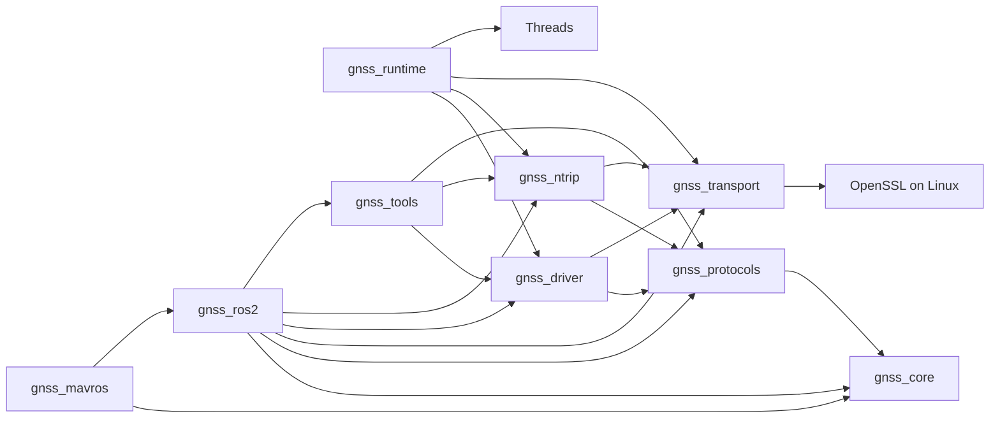

# Lot 5A — Dependency audit and first core-group move

Audit base: `bfcfed1e9d2e0e23398fc466247c6570fb15e782`, verified merge of PR 15
into `origin/dev`. Protocols are already under `protocols/gnss_protocols/`.
The study covers five components; only `gnss_core` is selected for this commit.

## Phase A — Dependencies and source-path risks

Arrows below mean **depends on**, not data flow. `protocols`, `tools`, ROS2 and
MAVROS are shown to expose consumers outside the five studied components.



Direct library edges come from each component's `target_link_libraries`;
ROS2 also reconstructs the listed common components from their source paths.
MAVROS uses the core target when available and installed ROS2 includes/exports
in its standalone package build. Core is transitively available to driver,
NTRIP, tools and runtime through protocols; these are not separate copies.

| Component | Direct internal dependencies | Consumers | Source paths used elsewhere | Build constraints and relocation risks |
| --- | --- | --- | --- | --- |
| `gnss_core` (10 files) | None | Protocols and MAVROS targets; ROS2 source/header installation; transitively driver/NTRIP/tools/runtime | Root CMake, ROS2 include/add_subdirectory, two ROS2 CI workspace symlink sources, formatter, manifest and generator fixtures | C++17 INTERFACE/header-only target; no native binary or own install rule. Central model has broad reach, but path references are centralized and formatting already passes. Installed ROS2 copies must retain `include/universal_gnss/...`. |
| `gnss_driver` (73 files) | Protocols, transport; core transitively | Runtime, ROS2 receiver, tools/configuration/discovery consumers | Root/ROS2 CMake, formatter, manifest; public namespace is not a source path | C++17 compiled library; POSIX-dependent discovery/test paths are platform-conditional. Sessions/profiles/freshness must remain byte-identical; changes to ownership/lifecycle logic would exceed a move. |
| `gnss_transport` (30 files) | None as internal CMake targets | Driver, NTRIP, runtime, ROS2 reconstruction and native tools | Root/ROS2 CMake, formatter, manifest; NTRIP/runtime point to `gnss_transport/tests` and TLS fixtures; manifest audited reference edge | C++17; Linux selects POSIX/TCP/UDP and OpenSSL plus public feature macros. Shared test helpers/fixtures give it the highest cross-directory coupling; moving only library sources would miss those consumers. |
| `gnss_ntrip` (32 files) | Protocols, transport; core transitively | Runtime supervisor, ROS2 NtripNode and tools/monitor | Root/ROS2 CMake, formatter, manifest, manifest reference owner; tests use root-relative transport helpers/TLS fixtures | C++17; Linux caster/TLS tests and steady-clock cancellation/reconnect evidence. Preserve GGA cadence/observation provenance and RTCM semantics; fixture paths must be handled atomically. |
| `gnss_runtime` (8 files) | Driver, NTRIP, transport; protocols/core transitively | Native `universal_gnss_supervisor` and two runtime test targets; no ROS2/MAVROS consumer | Root CMake; generator excludes/forbidden prefixes and isolated-runner absence assertion; tests use transport helpers/TLS | Threads; serial factory/executable and POSIX test are Linux-only. Excluded from pilot distributions. A direct clang-format-21 audit finds pre-existing formatting violations in `src/posix_serial_factory.cpp`; runtime is absent from automatic formatter roots. Resolving that debt while preserving every byte needs a separate scoped decision. |

Shared fixtures are an additional test dependency, not a new production library
edge. All five components are built through the root project (CMake >=3.22).
Docker's production build uses ROS2 package base paths and a root COPY; it does
not directly name the five source folders. The generator's component graph and
ownership selectors are distinct from system dependencies (OpenSSL/Threads/ROS).
The standalone runtime remains excluded from the ROS2 pilots.

## Choice and next migrations

Move **only `gnss_core/` → `core/gnss_core/`** first. It is already formatted,
header-only, has no internal dependency, no transport/OS source split and no
cross-component fixture directories of its own. Its ten files can retain their
complete subtree identity. Broad consumer reach is addressed by full native and
isolated ROS2/MAVROS validation rather than changing the model.

The runtime leaf was considered, but its unqualified distribution/exclusion
boundaries and existing formatting debt make it a less suitable first move
under the simultaneous byte-identity and formatting requirements. This lot
records that pre-existing issue without fixing it or weakening a check.

Recommended later atomic PRs: driver, then NTRIP, then transport, then runtime.
Re-audit each baseline before starting. Driver/NTRIP references are largely
centralized; transport must update all remaining shared-fixture consumers in its
own PR. Runtime additionally needs an explicit treatment of its formatting debt
and native-only packaging boundaries. This is an order proposal, not authority
to move or refactor those four components now. None of these moves implies
Humble/ESP32 support or a functional version change.

## Contracts and historical references

Preserve `universal_gnss_core` as an INTERFACE target and `universal_gnss/...` as
the public include namespace. The model, coordinate precision, clock domains,
freshness, sequence/provenance, incarnations and invalidation contracts remain
identical. All other library targets, package names, ROSIDL, exports, executables,
launch files, parameters, NTRIP/RTCM and driver behavior remain unchanged.

Core has no native install target. Its public headers are installed by ROS2's
existing `install(DIRECTORY ... DESTINATION include)` rule; update only the
source include variable. Retain its ROS2 binary subdirectory and CI symlink
destination names. No installed directory is renamed with the source folder.

Frozen reports/handoffs remain untouched: root `CURRENT_MAIN_AUDIT_DELTA.md` and
`UNIVERSAL_GNSS_AUDIT.md`, ROS2 audit/mapping reports, campaign reports/scripts,
recorded status evidence and `.agent/shared/checkpoints` baselines. Their old
paths refer to recorded commits. Resolve historical core references using Git,
for example:

```bash
git show bfcfed1e9d2e0e23398fc466247c6570fb15e782:gnss_core/include/universal_gnss/gnss_runtime_state.hpp
```

## Implementation and validation

The selected subtree must be copied by `git mv` without editing any of its ten
files or executable modes. Active source references change only in root/ROS2
CMake, two ROS2 CI symlink sources, formatter ownership, the manifest selector,
generator fixtures/assertions and current documentation. MAVROS links targets
or installed ROS2 exports, so needs no source adjustment. Other components,
protocol sources, Dockerfiles, publication workflows and generator implementation
are unchanged. A sibling under `core/` must not become implicitly distributed.

The original `gnss_core` subtree and relocated `core/gnss_core` subtree both have
Git identity `d5699324f95f040fa5c548e3e57f6f6fb451022b`: all ten blobs and their
modes are identical. The four other studied components and the protocols subtree
are unchanged. Public names, version files, ROSIDL and historical evidence are
unchanged; the manifest dependency graph is identical apart from the core path
selector. The two CI changes alter only symlink sources, preserving destinations
and all build/test commands. No publication workflow changes.

Validation on 2026-11-09:

| Check | Result |
| --- | --- |
| Native Release configure/build/install | PASS; installed paths and executable modes match the prior lot's 33-file native installation |
| Targeted core CTest | 3/3 PASS |
| Complete native CTest | 68/68 PASS |
| Existing Python tooling tests | 55/55 PASS |
| Generator and CI tests | 75/75 PASS (46 generator/integration + 29 CI/policy); includes rejection of an unclassified sibling under `core/` |
| Eight Kilted/Lyrical combinations: default, MAVROS, Docker, MAVROS+Docker | Generation, source integrity and reproducibility PASS |
| Isolated Kilted | Two packages built; 165 tests, no errors/failures/skips |
| Isolated Lyrical | Two packages built; 166 tests, no errors/failures/skips |
| Isolated Lyrical + MAVROS | Three packages built; 168 tests, no errors/failures/skips |
| Formatting | All tracked owned C/C++ files PASS via the repository clang-format-21 selector; nine moved C/C++ files also checked directly |
| Docker inputs, active paths, shell/Python/YAML syntax, local documentation links | PASS |
| Dashboard, checkpoint audit, historical campaign/link checker, diff whitespace | PASS; functional progress counters and historical evidence unchanged |

The generator reads committed objects. Before the final work-branch commit, its
staged tree was exported to a disposable local Git repository and committed there
as `4b8e503c72986e4db3600137e61f246cca2a37dc`. That immutable candidate supplied
all isolated builds; it is validation scratch, not a distribution publication.
After adding this report, regeneration from the final commit must match the
tested source inventories and manifest hash. The only candidate-to-final changes
are report documentation excluded from the distributions.

Manifest SHA-256: `e956172316eaba7e05f6af0aaffb2c90529f24d848ab41450f3cece36644fe78`.
Source inventory SHA-256 (same for both ROS2 profiles):

| Options | Inventory SHA-256 |
| --- | --- |
| Default | `f84d641dc4872ad487e0cb95a1ddce8fa3acb8f0997ec451eb2c85cbd3dc2ef0` |
| MAVROS | `4cadb9b131c8c6bbfe6766f403d4e430be5d0034b405df65f7c5e1b0ad706240` |
| Docker | `87155dba0e98d1410a8b4f0187614b6ecec5d597e09690845f549fb3c8bdd99b` |
| MAVROS+Docker | `760823b0e512c58473cc080174147bc0fb082cd9e5f5640eaf85c9e21b3cfc48` |

Builds run as the normal project user (UID 1000); isolated builds receive only
generated sources, without network or excluded source mounts. They reuse the
three dependency images identified in the [lot 3 validation record](CI.md).
Image provisioning was not repeated. The current Docker entry points and
optional Docker payload are verified without building production Docker images.

Not executed: Kilted+MAVROS compilation, ARM, Humble, ESP32, hardware, receiver
sessions, remote GitHub Actions or publication/protection trials. The runtime
formatting audit failure above is pre-existing, outside the selected component
and outside the unchanged automatic formatter selection; it is not a passing
runtime-wide formatting qualification. A ROS2/software PASS does not qualify
receiver hardware or close physical validation gates. No new downstream robot
work or functional progress credit follows from this source-only move.
