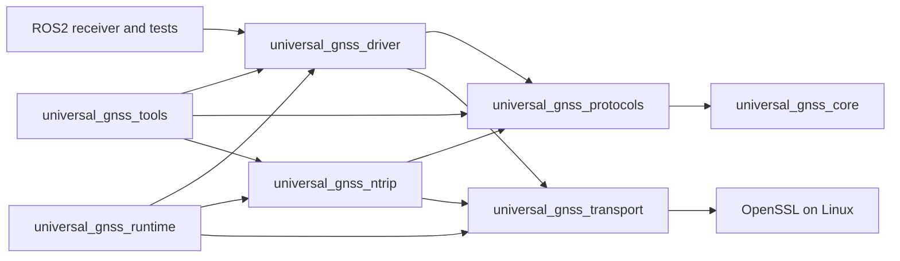

# Lot 5B — Atomic driver relocation

Base: `d712ff70ff7fbe89157a662699c2e72ac78dc47e`, the verified PR 16 merge
in `origin/dev`. Branch: `refactor/move-gnss-driver`. This lot relocates only
`gnss_driver/` to `core/gnss_driver/`, independently of functional UG versioning.
The pre-edit audit found 73 tracked files and subtree identity
`08f63924744566b5c3d0146682e5d6d618b27894`.

## Dependency audit

Arrows mean **depends on**. These are library edges, not data flow; ROS2 also
reconstructs common targets through source directories.



| Surface | Verified dependency / source reference | Treatment |
| --- | --- | --- |
| Driver CMake | C++17; PUBLIC protocols and transport; current-source-relative `src/`, `tests/`, `include/`; 20 driver test executables | Preserve the complete component, including CMake and tests, byte for byte |
| Native root | `add_subdirectory(gnss_driver)` | Change only the source path |
| ROS2 CMake | `${UNIVERSAL_GNSS_SOURCE_ROOT}/gnss_driver` | Change only that source path; preserve `${CMAKE_CURRENT_BINARY_DIR}/gnss_driver`, targets, installation and exports |
| Runtime and tools | Link the existing driver target; include `universal_gnss_driver/...` | No changes |
| MAVROS | Uses the common model and ROS2 installed exports/plugin contracts; no driver source path | No changes |
| Docker / Compose / CI | Root Docker COPY, package-based colcon entry points, no explicit driver source directory | No Docker or workflow changes; verify generated COPY inputs and isolated consumers |
| Formatter | Owned component root `gnss_driver` | Select `core/gnss_driver`, preserving the same owned files |
| Manifest | Component `driver`, requiring `protocols` and `transport` | Change only its source selector; preserve all 13 components, edges, options, platforms and exclusions |
| Generator tests | Real pilot closure assertions; existing rejection of an unclassified sibling under `core/` | Assert relocated header/source presence and old-root absence; retain existing safety tests and generator implementation |
| Current docs | README, refactor status, distribution component table, transport bridge, current auto-configuration pointers and Unicore profile pointers | Update only active source references |

There are no cross-directory fixture paths inside driver CMake/source files.
Transport still owns the TLS fixtures shared by NTRIP/runtime; those paths and
components stay in place. The native runtime remains excluded from ROS2 pilots.
No dependency edge or public include is renamed as a consequence of relocation.

## Public contracts and historical boundaries

Preserve `universal_gnss_driver`, its library name and
`universal_gnss_driver/...` headers. The component's existing install rule still
installs the library to `lib/` (or its existing platform-dependent destination);
no new header-install/export rule is added. ROS2 packages, ROSIDL, executables,
parameters, launch files, installed paths and exports remain unchanged.

The relocation must not change `ReceiverSession`, discovery, family/model
detection, profiles, planning/application/rollback, command/response semantics,
timeouts/reconnects, incarnations, sequences/provenance, precision or NTRIP/RTCM.
All implementation and tests travel unchanged; behavior is validated through
the existing native and isolated consumer suites.

Historical references deliberately retain their recorded paths: root audits,
`docs/ros2_end_to_end_audit.md`, validation campaigns and frozen scripts,
shared checkpoints and the preceding `CORE_MOVE.md` / `PROTOCOLS_MOVE.md` reports.
The old proposed-milestone file list in `docs/auto_configuration.md` is a design
snapshot; only its current implementation pointers are updated. Hardware
outcomes and historical validation sections are not rewritten. To resolve an
old path, use the recorded commit, for example:

```bash
git show d712ff70ff7fbe89157a662699c2e72ac78dc47e:gnss_driver/src/receiver_session.cpp
```

The pre-existing runtime formatting debt remains outside this lot. No downstream
robot behavior or public ROS2 surface changes, so this move adds no downstream
implementation task or functional progress credit. TODO/ROADMAP functional
counts and validation gates remain unchanged; structural status is tracked in
`TODO_REPO_REFACTOR.md`.

## Validation and identity

Results on 2026-11-09:

| Check | Result |
| --- | --- |
| Moved component | 73 exact renames; identical blobs, names relative to the component and Git modes; original root absent |
| Subtree identity before/after | `08f63924744566b5c3d0146682e5d6d618b27894` |
| Native Release configure / build / install | PASS |
| Native installed files compared with the base | All 33 files byte-identical, with identical paths and full permission modes; includes `lib/libuniversal_gnss_driver.a` and existing executables |
| Driver CTest | 20/20 PASS |
| Full native CTest | 68/68 PASS |
| Existing Python tooling unit suite | 55/55 PASS |
| Generator and CI/policy tests | 75/75 PASS; unclassified `core/` sibling rejection retained |
| Eight profile/option combinations | Generation, integrity and reproducibility PASS |
| Isolated Kilted | Two packages built; 165 tests, no errors/failures/skips |
| Isolated Lyrical | Two packages built; 166 tests, no errors/failures/skips |
| Isolated Lyrical + MAVROS | Three packages built; 168 tests, no errors/failures/skips |
| Source payload comparison against base, all eight configurations | Same selected components and every source byte/mode, after only translating driver paths and the ROS2 source-reference line |
| Formatting | All 72 moved C/C++ files and the global tracked owned selection PASS with clang-format-21 |
| Shell/Python/manifest syntax, current links and active paths | PASS; old-root matches classified as historical, relocation descriptions or negative test assertions |
| Docker COPY inputs / entry points | PASS through unchanged Dockerfiles/Compose/runner, existing Python contract tests and all optional Docker generation closures |
| Dashboard / shared checkpoint audit / frozen campaign evidence / whitespace | PASS; counters, shared checkpoints and historical evidence unchanged |

The comparison installation is the preceding lot's Release installation. Its
input commit `56c2c0a393d3de2d67719b695cfdebbfd3dff6ab` has exactly the same
root tree as this lot's merge base, not merely similar sources. No baseline
artifact is regenerated or altered during comparison.

The generator reads committed objects. A disposable local repository captured
the exact staged candidate tree as commit
`46cdeb4cd14c0e54ae89c212d8e95a41f1ab428e`, supplying the eight generation
runs and all three isolated builds. Its root tree is
`ee4297664925dd227353c7a7c2f6f6591810c494`. Only this excluded report changes
after that candidate; the final local commit is checked by regeneration against
the candidate's source inventories and manifest hash.

Manifest SHA-256: `19b72f3904cdfde6ff4f1f3d103d31139db7e5237c3f0e06e281604de27cdbca`.
The two ROS2 profiles share these source-inventory SHA-256 values:

| Options | Inventory SHA-256 |
| --- | --- |
| Default | `b9cf087dba84737e222ae9ce31ab5d7d6abffa2b793700873e4150c88ed1f1c1` |
| MAVROS | `f4d35db6477084c34dd177a6c3bd782c794a9fe470b79ce5ccce25034416684e` |
| Docker | `86e6c21d7fc33dbb85a91b952587fa514c914fe61c1bf8a6e3a9d6153160aa61` |
| MAVROS+Docker | `16dbb9519a39de9d72979ca79dec405d2bf89b1a51888efc8b7079b140073750` |

All project generation/build/test commands run as the normal user, UID 1000.
The unchanged isolated runner streams only generated files into containers,
with no network, source mounts or inherited UG overlay. It reuses the three
dependency image identities recorded in the [lot 3 validation record](CI.md);
those identities were rechecked, without rebuilding the images.

Relevant commands include:

```bash
cmake -S . -B /tmp/ug-lot5b-native -DCMAKE_BUILD_TYPE=Release
cmake --build /tmp/ug-lot5b-native --parallel 4
ctest --test-dir /tmp/ug-lot5b-native -R '^gnss_driver_' --output-on-failure
ctest --test-dir /tmp/ug-lot5b-native --output-on-failure
cmake --install /tmp/ug-lot5b-native --prefix /tmp/ug-lot5b-native-install
PYTHONDONTWRITEBYTECODE=1 python3 -m unittest discover -s scripts/tests -v
PYTHONDONTWRITEBYTECODE=1 python3 -m unittest discover -s tools/branches/tests -v
```

The latter generator suite uses the immutable candidate before the work-branch
commit. All eight combinations execute the existing workflow's generation step
with that explicit SHA. The three isolated validations use `validate_ci.py`
with `--build-image`, so build/test execution is mandatory rather than skipped.

Not executed: Kilted+MAVROS compilation, ARM, production Docker image builds,
dependency image provisioning, Humble, ESP32, physical receiver sessions,
remote GitHub Actions, publisher/protection trials or any publication. The
runtime formatting debt is not corrected or qualified by the unchanged
formatter selection. No hardware result follows from a software PASS.

## Exact accompaniment scope

Outside the 73 renamed files, only these twelve files change:

```text
CMakeLists.txt
README.md
TODO_REPO_REFACTOR.md
docs/auto_configuration.md
docs/transport.md
docs/vendors/unicore/config_profiles.md
gnss_ros2/CMakeLists.txt
scripts/clang_format_21.sh
tools/branches/DRIVER_MOVE.md (new)
tools/branches/README.md
tools/branches/manifest.yaml
tools/branches/tests/test_distribution.py
```

No other component, version, functional implementation, interface, workflow,
historical report or shared checkpoint changes. The only local work-branch
commit contains this scope; no push or PR is part of this lot.

## Following lots

Re-audit NTRIP next, then transport including its shared-fixture consumers, then
runtime with a separate decision about its existing formatting/native packaging
boundaries. Those components are not moved or edited here. No Humble, ESP32,
GUI, BlueOS, backend, publisher, version or remote distribution work is included.
