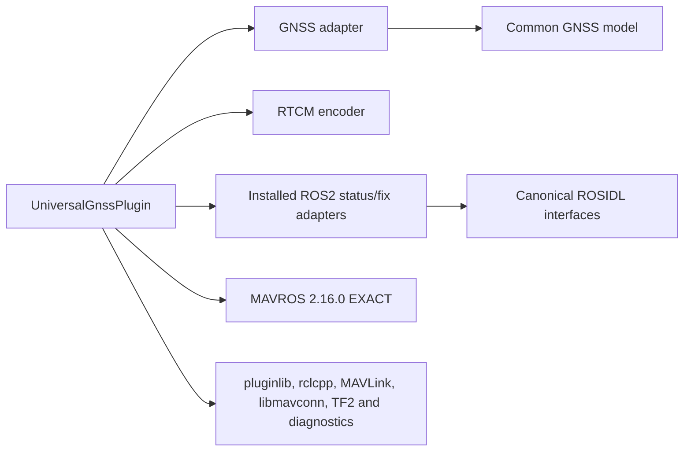

# Lot 8 — Atomic MAVROS adapter relocation

Base: `460433094605823d641b8403605103fa90cf3cad`, verified PR 21 merge at
`origin/dev`. Branch: `refactor/move-gnss-mavros`. Only `gnss_mavros/` moves to
`adapters/mavros/gnss_mavros/`; no functional, protocol, interface or version change.

The final local commit adds this report and is titled
`refactor(repo): relocate GNSS MAVROS adapter without behavior changes`:

```bash
git log -1 --diff-filter=A --format='%H %s' -- tools/branches/MAVROS_MOVE.md
```

The initial lot 8 validation below records candidate
`036f4eccc5251c83dda33959ab2bbe254dff4897` and its temporary build input.
The independent pre-PR review found two generator issues; the appended lot 8B
section records their corrections and supersedes the initial guard qualification.
The relocated component itself is unchanged.

## Pre-edit audit and exact inventory

The source/dependency audit completed on the clean expected base before editing
project files. All 11 tracked files are mode `100644`; their original subtree is
`accdf47639538c84c78981de642a08b5a5d88d21`:

```text
CMakeLists.txt
README.md
include/universal_gnss_mavros/mavlink_gnss_adapter.hpp
include/universal_gnss_mavros/mavlink_rtcm_encoder.hpp
package.xml
src/mavlink_gnss_adapter.cpp
src/mavlink_rtcm_encoder.cpp
src/universal_gnss_plugin.cpp
tests/test_mavlink_gnss_adapter.cpp
tests/test_mavlink_rtcm_encoder.cpp
universal_gnss_mavros_plugins.xml
```

Internal source/include/test paths use the current source directory or relative
paths; installation uses package identity and relative destinations. The package
XML and plugin XML contain installed identifiers, not the repository root path.
The README uses package-based colcon instructions, not a physical source path.
No internal edit is necessary. CMake, README, sources, headers, tests and both
XML files remain byte/mode identical.

| Active external reference | Treatment |
| --- | --- |
| Root CMake | Translate only optional add_subdirectory source path |
| Manifest | Translate six precise selectors and existing README exclusion; no broad adapters selector |
| Generated instructions | Translate MAVROS colcon base path, preserve package name and options |
| Isolated runner | Translate optional package directory/base path, retain selection/tests and add old-root absence guard |
| Synthetic fixtures and CI tests | Follow relocated source paths; retain failure-propagation checks |
| Current README, ROS2 guide, refactor table and distribution table | Translate current source pointers only |
| Formatter/CI/Docker/Compose | No active physical MAVROS source path; keep policy and files unchanged |
| Historical reports/shared checkpoints | Preserve original bytes and old references |

Colcon discovers `universal_gnss_mavros` from package.xml beneath the new explicit
base path. `gnss_ros2` and `universal_gnss_msgs` retain their current paths and
names. The default distribution has no MAVROS package; the option adds exactly
one package. No external private consumer of source paths can be enumerated by
this repository-local audit.

## Dependencies and public contracts



C++17 and PIC, PUBLIC include paths and integrated PUBLIC core link are unchanged.
The standalone adapter uses the installed ROS2 include prefix. The RTCM encoder
remains MAVROS-free. The plugin's link dependencies, visibility and conditions
are unchanged, including Eigen, GeographicLib, diagnostic_updater,
rclcpp_components, rcpputils, sensor_msgs, tf2_eigen and tf2_ros.

Preserved identities:

- ROS2 package `universal_gnss_mavros`, existing package version `0.7.0`.
- Libraries/targets `universal_gnss_mavros_adapter`,
  `universal_gnss_mavros_rtcm_encoder`, `universal_gnss_mavros_plugin`.
- Public headers `universal_gnss_mavros/...` and ament exports.
- Plugin name `universal_gnss`, class
  `mavros::plugin::PluginFactoryTemplate<universal_gnss_mavros::UniversalGnssPlugin>`,
  base `mavros::plugin::PluginFactory`.
- Installed descriptor
  `share/universal_gnss_mavros/universal_gnss_mavros_plugins.xml`, library
  `lib/libuniversal_gnss_mavros_plugin.so`, headers under include and package
  resource names. Standalone registration uses `mavros__pluginlib__plugin`.
- MAVROS `2.16.0` EXACT, documented upstream commit
  `5c68b905ab30de6ce630822dc46c33467e8f23ea`; no dependency provisioning/update.
- GPS_RAW_INT/GPS2_RAW, GPS_RTK/GPS2_RTK and SYSTEM_TIME handlers; GPS_RTCM_DATA
  output with the existing fragmentation, sequence and size contracts.
- Topics `~/gps1/status`, `~/gps2/status`, `~/gps1/fix`, `~/gps2/fix`, and the
  `rtcm_input_topic` parameter (default `/rtcm`). Parameters source_id_prefix,
  gps1_frame_id and gps2_frame_id retain their defaults and semantics.

No change to observations, precision, time domains, source incarnation,
freshness, invalidation, conversion or publication logic. Factory loading below
never creates a UAS/FCU instance or claims live vehicle operation.

## Separate build-mode audit

Standalone colcon defaults the external plugin ON, requires installed ROS2 and
MAVROS, and finalizes ament exports/index through ament_package(). The root
integrated option also requires an installed ROS2 prefix, but does not finalize
the package with ament_package(). These modes are not equivalent.

On the base, standalone build and the two adapter/encoder tests pass. A real
pluginlib ClassLoader discovers `universal_gnss` and creates its PluginFactory
from the installed shared library, without instantiating a hardware plugin.
The integrated plugin and both tests also build/pass, but its ament plugin
resource is absent. This pre-existing integrated registration limitation is
preserved, not repaired or presented as successful automatic plugin discovery.

The moved README's statement that the normal default root build tests the free
adapter does not describe the current root CMake: the entire subdirectory is
conditional on the plugin option. Default native testing remains 68 tests.
The README is preserved to keep the subtree exact; this discrepancy is recorded
here instead of silently changing a moved file.

## Distribution guards and justified generator changes

The 13 components, dependency graph, options, profiles, exclusions and package
versions remain unchanged. Only MAVROS selectors and the existing README
exclusion follow the move. Its ten distributed source files stay optional;
the eleventh tracked file, README.md, remains excluded as before. Native runtime,
generator implementation, agent/CI directories and development scripts stay out
of the generated distributions. No global `adapters/` selector is introduced.

Two pre-edit in-memory probes demonstrated missing checks: a duplicate package
under an owned MAVROS source subtree and an invalid plugin library name were
silently accepted. Minimal general checks now reject duplicate ROS package
identities and verify the existing package XML plugin path, literal CMake
pluginlib export and descriptor library target. No class/topic/parameter or
package metadata is rewritten. These checks support the current literal
plugin/CMake contract; they are not a general CMake evaluator.

Eight new negative tests cover legacy root, missing package, duplicate package,
unclassified adapter sibling, injected MAVROS without option, omitted MAVROS
with option, invalid plugin paths (three variants), and undeclared external
MAVROS dependency. Existing TLS, tools fixture, runtime and classification
controls remain active. An actual CMake configuration with MAVROS explicitly
unavailable must also fail, rather than silently disabling the plugin.

## Validation

Results on 2026-11-09, all project commands under normal user UID 1000:

| Check | Observed result |
| --- | --- |
| Relocation | 11 R100; identical blobs/modes and subtree `accdf47639538c84c78981de642a08b5a5d88d21`; old root absent |
| Fresh default native Release configure/build/install | PASS |
| Complete default native CTest | 68/68 PASS; MAVROS is not selected by this default root build |
| Default native installed artifacts vs lot 7 | All 33 files identical bytes, paths and full permissions |
| Existing Python tooling tests | 55/55 PASS |
| Generator and CI tests | 98/98 PASS (69 generator/integration + 29 CI/policy) |
| Eight generated configurations | Generation, integrity, independent reproducibility and translated source inventory equivalence PASS |
| Colcon package selection | Exactly two packages without MAVROS, three with it; one relocated MAVROS package and no old-root copy |
| Kilted isolated standard | Build PASS; 165 tests, zero errors/failures/skips |
| Lyrical isolated standard | Build PASS; 166 tests, zero errors/failures/skips |
| Lyrical isolated with MAVROS | Build PASS; 168 tests, zero errors/failures/skips, including both adapter tests |
| Standalone mode, base and candidate | Build plus 2/2 MAVROS tests PASS; pluginlib factory discovery/loading PASS |
| Candidate standalone installed contracts | Package XML, descriptor and two headers byte-identical to sources; expected resource marker and shared library present |
| Integrated mode, base and candidate | Plugin build and 2/2 focused CTests PASS; automatic ament discovery is NOT qualified |
| Candidate integrated subdirectory installation | XML, shared library, two adapter libraries and headers installed; ament plugin index absent as on the base |
| Simulated unavailable external MAVROS | Expected CMake refusal, raw exit 1; REQUIRED dependency is not silently disabled |
| Syntax, current links, active paths, Docker inputs | PASS; Dockerfiles/Compose/publication workflows unchanged |
| Dashboard/shared checkpoint audit | PASS; 10 indexed entries, no problems/warnings; functional counters unchanged |
| Existing owned-root formatter | PASS, unchanged selection policy; MAVROS/runtime remain outside scope |
| Direct MAVROS formatting | Raw exit 1, 111 pre-existing diagnostics, identical before/after; NOT PASS |
| Direct runtime formatting | Raw exit 1, 28 unchanged diagnostics; NOT PASS |
| Frozen campaign checker | Raw exit 1, same three TLS test-key alerts; NOT PASS |
| Docker Compose | Plugin absent, version command exit 1; configuration NOT EXECUTED |
| Frozen evidence and diff whitespace | PASS |

Native reference `/tmp/ug-lot7-install` comes from the exact source tree merged
as this lot's base; the merge tree equals the accepted lot 7 source tree.
The new build and install are `/tmp/ug-lot8-native` and `/tmp/ug-lot8-install`.
Reference artifacts are not changed. Default native installation comparison
must not be confused with qualifying the pre-existing native SDK as autonomous.

### Immutable input and image isolation

Generator tests, eight-tree checks and isolated builds read committed candidate
`66d17f1314eacdfe5e1e394ab577f253f8bc8e8a`, root tree
`3306272493675213701a9e803643752669ce8a68`, in a disposable local repository.
Only this excluded report changes afterward. Final work-branch commit generation
verifies matching manifest/inventory hashes and the same generator bytes as the
compiled isolated inputs; the final SHA is resolved by the command at the top.

The three generated-distribution runs use dependency-only cached images:

- Kilted: `sha256:0eb6163dd3943411718e8355430a319b86d1baca11d84a0930ef81b73e7ce8cf`.
- Lyrical: `sha256:2c2b6e77472c03a522de6442344aac64ad9a1df1723fd7b506e6a346627f9029`.
- Lyrical/MAVROS: `sha256:8404b5a397f5eeeb98d673184cfc9748324a80672bf18086914aa71cafba12af`.

They stream only the generated source tree, with no network or repository mount,
cleared environment and no inherited UG overlay. No dependency is downloaded,
rebuilt or installed. The separate build-mode comparison streams the full Git
archive into the existing MAVROS image, because integrated mode needs the native
root CMake/runtime excluded from distributions. It is explicitly not a fourth
generated-distribution build.

### Eight configurations and inventories

Both profiles keep the same selections and counts:

| Options | Components | Copied sources | Total files |
| --- | --- | --- | --- |
| Default | 11 | 308 | 312 |
| MAVROS | 12 | 318 | 322 |
| Docker | 12 | 316 | 320 |
| MAVROS+Docker | 13 | 326 | 330 |

After translating only the MAVROS source prefix, every copied byte and mode is
identical to the base. Default/Docker source inventories do not change.
Generated instruction paths, source identity, embedded manifest and generator
hash metadata change as expected; schema, format version and UG/package
versions do not. No package is introduced without its option. All eight trees
were independently generated twice and checked on disk, with no native runtime,
generator or development-directory leakage. The pre-existing healthcheck test
and optional Docker support collector remain the only selected scripts.

Manifest SHA-256: `0a38591ace51cfd016c55e8cfac3040eeeee129c2e3d7dc226de3b6649b83c45`.
Inventory hashes apply to both profiles:

| Options | Inventory SHA-256 |
| --- | --- |
| Default | `a39df0fb942ab2e8ea107645d832cc0a8305771d4873483c232c48f7bd5aea55` |
| MAVROS | `d7cd5c2b5d3caa2f7721d3d092a4995765be66d25d5692399cb47e130b120daa` |
| Docker | `6d39f4a3f696f78a8af45ba4b7cefdcc6a724322488879969c3b193b4f99f35a` |
| Both | `419c7fdece244a3cf8f03c50391c5aad2715968f073f171fbe275af1d49e7a1f` |

### Plugin and mode evidence

The standalone probe uses the real pluginlib ClassLoader with base
`mavros::plugin::PluginFactory`, discovers `universal_gnss` through ament and
creates its factory. On both base and candidate it resolves exactly to the
current standalone installation's `lib/libuniversal_gnss_mavros_plugin.so`.
It does not invoke `create_plugin_instance(UASPtr)` or create a vehicle node.
The installed descriptor/resource and original class/type/library identifiers
are checked independently of compilation.

The controlled dependency-negative configuration sets
`CMAKE_DISABLE_FIND_PACKAGE_mavros=TRUE`: CMake returns 1 stating that a REQUIRED
package cannot be disabled. This is an expected negative test, not a successful
plugin configure or evidence that the cached image lacks MAVROS.

Integrated validation uses root `UNIVERSAL_GNSS_BUILD_MAVROS_PLUGIN=ON`, with
`UNIVERSAL_GNSS_BUILD_ROS2` left OFF and the just-built installed ROS2 prefix.
It builds the plugin and both adapter tests, runs the two tests explicitly, and
installs the MAVROS subdirectory. XML and libraries exist, but there is no
`mavros__pluginlib__plugin/universal_gnss_mavros` index resource. The unchanged
CMake only calls ament_package() in standalone mode, so integrated automatic
plugin discovery is not claimed. Supporting that separately would require an
explicitly authorized compatibility/packaging change outside this move.

The validation harness uses explicit colcon base paths and current Lyrical
imported targets. Initial temporary harness attempts with default root discovery
(zero tests), a removed ament macro, and an upstream header include-order issue
were rejected and corrected before accepting evidence. No production file was
changed to make those harness attempts pass. Accepted logs contain two actual
adapter/encoder tests and real factory loading.

Relevant reproducible native commands:

```bash
cmake -S . -B /tmp/ug-lot8-native -DCMAKE_BUILD_TYPE=Release
cmake --build /tmp/ug-lot8-native --parallel 4
ctest --test-dir /tmp/ug-lot8-native --output-on-failure
cmake --install /tmp/ug-lot8-native --prefix /tmp/ug-lot8-install
PYTHONDONTWRITEBYTECODE=1 python3 -m unittest discover -s scripts/tests -v
PYTHONDONTWRITEBYTECODE=1 python3 -m unittest discover -s tools/branches/tests -v
bash scripts/clang_format_21.sh --check --all
```


## Known debts and limits

Before the move, the seven MAVROS C/C++ files already produce raw formatter exit
1 with **111 diagnostics**. MAVROS is outside the existing explicit owned roots;
this lot neither broadens that policy nor adds an exclusion. Preserve the same
seven blobs and identical diagnostics after path normalization. No formatter
apply operation is used.

Separately, runtime retains its 28 known direct formatting diagnostics. The
historical scanner retains raw exit 1 on the three existing transport TLS test
keys. Neither result is PASS; keys, certificates, scanner and historical
campaign evidence remain untouched. Docker Compose availability and the
pre-existing non-autonomous native SDK remain separate limits.

No hardware, new backend, Humble, ESP32, GUI, BlueOS or publication work belongs
to this lot. No push, PR, merge, tag, Release or remote distribution is created.

## Raw historical result and residual scope

The frozen scanner returns 1 with exactly:

```text
FAIL: credential pattern requires review: core/gnss_transport/tests/fixtures/tls/ca.key
FAIL: credential pattern requires review: core/gnss_transport/tests/fixtures/tls/client.key
FAIL: credential pattern requires review: core/gnss_transport/tests/fixtures/tls/server.key
```

It examines 337 candidate paths and 160 relative Markdown targets. The frozen
SVG identity remains `5ab9e6e00e42273cb22497a82f087cd44a08626eb00252a292536e995c525080`.
The rename-scanning behavior, keys, scanner, reports and evidence are unchanged;
no security exception is added. Current Actions only syntax-compile this scanner.

Not executed/qualified: integrated automatic plugin discovery, simultaneous root
ROS2+MAVROS builds, Kilted+MAVROS, production Docker image builds, new dependency
image provisioning, Compose configuration, non-Linux/ARM, live UAS/FCU/plugin
instance operation, physical receiver/network/reconnect qualification, Humble,
ESP32, GUI, BlueOS, remote Actions or publication/protection trials. Software
factory loading is not a claim of live GNSS/MAVLink operation.

Outside the eleven exact renames, only these eleven files change:

```text
CMakeLists.txt
README.md
TODO_REPO_REFACTOR.md
docs/ros2.md
tools/branches/MAVROS_MOVE.md (new)
tools/branches/README.md
tools/branches/distribution.py
tools/branches/manifest.yaml
tools/branches/test_isolated.sh
tools/branches/tests/test_ci.py
tools/branches/tests/test_distribution.py
```

No functional TODO/ROADMAP count or shared checkpoint changes. All previous MOVE
reports and historical validation material remain intact. One local work-branch
commit, no publication or unrelated cleanup.

## Lot 8B — Targeted guard correction after independent review

Scope: only this report, `distribution.py` and `tests/test_distribution.py`.
The original 11 exact renames, MAVROS subtree and all other lot 8 files are
preserved. The existing local commit is amended after validation, without
publishing or adding a second work-branch commit.

### Reproduced defects

The original base algorithm accepted all four review mutations. The initial
lot 8 candidate incorrectly rejected a quoted literal add_library target and
accepted a commented target, a wrong pluginlib category and a STATIC plugin.
Both default and MAVROS generation rejected a duplicate package located only
in the excluded docs tree; the base algorithm accepted that excluded example.
These cases were independently reproduced again before lot 8B edits.

### Minimal corrections and static-analysis contract

Package-name uniqueness now applies only to selected package.xml files.
Classification controls exclusions at any path, without a docs-specific
exception. The internal dependency catalog still identifies owned but unselected
packages to reject missing internal dependencies, but unselected duplicates
cannot override selected package identities. Excluded package XML files are
not parsed. Selected duplicates and unclassified sources remain rejected.

The plugin precheck tokenizes CMake syntax before inspecting only add_library
and pluginlib_export_plugin_description_file declarations. It ignores line and
bracket comments (including equal-delimited forms), keeps quoted and bracket
arguments distinct from commands, and accepts quoted/unquoted literal names.
It checks the plugin category against the package XML export element, the
exact descriptor path, the XML library name and an explicit SHARED or MODULE
source-built target. STATIC, INTERFACE, OBJECT and IMPORTED are not treated as
proof of a loadable built plugin.

This is not a CMake interpreter. It does not expand variables/generator
expressions, evaluate conditions, execute macros/functions/includes, or prove
that a syntactically declared target is actually built. Essential dynamic
names/types/categories are rejected with an explicit cannot-statically-prove
error, rather than reported as validated. Backslash/list expressions in those
essential arguments are likewise outside the supported subset. Real builds
and factory loading remain necessary; this precheck makes no runtime claim.

### Tests and validation

Twenty-five independent regression tests supplement all 98 existing tests.
They cover selected duplicates with/without MAVROS, excluded examples across
eight outputs, a classification exclusion outside docs, unparsed excluded XML,
unselected duplicates, quoted/unquoted/bracket literal arguments, line/bracket
comments, string decoys, category/export mismatch, dynamic type checks,
STATIC/IMPORTED rejection, MODULE acceptance, empty/missing descriptors,
unsupported prefixes, unknown libraries and explicit dynamic limitations.
Acceptance cases inspect actual planned files/metadata or full equality of
valid outputs; duplicate rejection has a distinct-name acceptance control.
The eight original lot 8 negative tests remain unchanged.

The reproduction matrix below compares the initial lot 8 candidate with the
corrected generator. ACCEPT/REJECT describe the observed planning result, not
a CMake execution result.

| Input mutation | Initial candidate | Corrected |
| --- | --- | --- |
| Quoted literal plugin target | REJECT (incorrect) | ACCEPT |
| Only a line-commented target declaration | ACCEPT (incorrect) | REJECT |
| Wrong pluginlib category | ACCEPT (incorrect) | REJECT |
| STATIC plugin library | ACCEPT (incorrect) | REJECT |
| Duplicate package only in an excluded example | REJECT (incorrect) | ACCEPT, eight outputs unchanged |
| Duplicate package among selected sources | REJECT | REJECT, with and without MAVROS |

All following checks were actually rerun for lot 8B, under normal UID 1000,
against committed corrected input
`e7b63f25cddbcb88dc1696260f6b4675e680a7f6`, root tree
`f5c1e8269fd65eb00c0b43ff34f64a0871f809e2`, in a disposable local repository.
The corrected generator SHA-256 is
`e5065a416244b05f7f949b39fe6fdae5077e2a5c882b0494e33868e4babfbeb3`.
Only this excluded report changes after that input is frozen. The final
amended work-branch SHA is resolved by the command at the top; final-commit
generation must preserve these generator bytes and the eight inventories.

| Check rerun on corrected input | Observed result |
| --- | --- |
| Generator/integration and CI suite | 123/123 PASS: 94 generator/integration and 29 CI; all original 98 retained unchanged, plus 25 new tests |
| Existing Python tooling suite | 55/55 PASS |
| Fresh default native Release configure/build/install | PASS; `/tmp/ug-lot8b-native` and `/tmp/ug-lot8b-install` |
| Complete native CTest | 68/68 PASS |
| Native installation vs accepted initial lot 8 installation | All 33 files identical in bytes, paths and full permissions |
| Eight generations, each independently repeated on disk | PASS: integrity, reproducibility, exact initial-candidate source bytes/modes and inventory hashes |
| Classification and distribution boundaries | PASS: 13 manifest components, unchanged closure and options; two ROS packages by default and three with MAVROS; runtime, generator and development directories excluded |
| TLS and tools fixtures, source entry paths, plugin metadata | PASS: explicit reference edges retained; copied payload and public metadata unchanged |
| Kilted isolated standard | Build PASS; 165 tests, zero errors/failures/skips |
| Lyrical isolated standard | Build PASS; 166 tests, zero errors/failures/skips |
| Lyrical isolated with MAVROS | Build PASS; 168 tests, zero errors/failures/skips |
| Standalone MAVROS | Build and 2/2 tests PASS; installed XML/headers/resource checked; actual pluginlib factory discovery and loading PASS |
| Integrated MAVROS | Plugin build and 2/2 focused CTests PASS; XML/library install checked; ament plugin index still absent, discovery NOT qualified |
| MAVROS dependency explicitly disabled | Expected REQUIRED-package configuration refusal, raw exit 1 |
| Python syntax, current links, dashboard/checkpoint audits, selected-root formatting and diff whitespace | PASS; historical scanner's only failures are the three unchanged TLS alerts below |
| Direct MAVROS formatting | Raw exit 1, 111 pre-existing diagnostics; NOT PASS |
| Direct runtime formatting | Raw exit 1, 28 pre-existing diagnostics; NOT PASS |
| Historical campaign scanner | Raw exit 1, exactly the same ca.key/client.key/server.key test-key alerts; NOT PASS |
| Docker Compose availability | Version command exits 1; plugin absent; configuration NOT EXECUTED |

The three isolated builds reuse exactly the three dependency image IDs listed
above, without network, provisioning or repository mounts. The standalone and
integrated checks reuse the existing MAVROS image and full Git archive, as
distinct from generated-distribution isolation. The standalone probe resolves
the factory to its own installed shared library, without creating a live UAS
or plugin instance. Compilation alone is not used as loading evidence.

The manifest hash and all four per-option inventory hashes in the initial
validation remain identical for both profiles. Default/MAVROS/Docker/both
retain respectively 312/322/320/330 total files. Comparison with initial
candidate `036f4eccc5251c83dda33959ab2bbe254dff4897` allows only generated
source-commit and generator-hash metadata, and the instruction's source SHA,
to change; all copied payload bytes, modes, package versions and instructions
otherwise match exactly. No distribution-policy change is introduced.

Representative commands from the committed corrected checkout:

```bash
PYTHONDONTWRITEBYTECODE=1 python3 -m unittest discover -s tools/branches/tests -v
PYTHONDONTWRITEBYTECODE=1 python3 -m unittest discover -s scripts/tests -v
cmake -S . -B /tmp/ug-lot8b-native -DCMAKE_BUILD_TYPE=Release -DCMAKE_INSTALL_PREFIX=/tmp/ug-lot8b-install
cmake --build /tmp/ug-lot8b-native --parallel 3
ctest --test-dir /tmp/ug-lot8b-native --output-on-failure
cmake --install /tmp/ug-lot8b-native
python3 tools/branches/validate_ci.py --source-ref e7b63f25cddbcb88dc1696260f6b4675e680a7f6 --distribution ros2-kilted --build-image sha256:0eb6163dd3943411718e8355430a319b86d1baca11d84a0930ef81b73e7ce8cf
python3 tools/branches/validate_ci.py --source-ref e7b63f25cddbcb88dc1696260f6b4675e680a7f6 --distribution ros2-lyrical --build-image sha256:2c2b6e77472c03a522de6442344aac64ad9a1df1723fd7b506e6a346627f9029
python3 tools/branches/validate_ci.py --source-ref e7b63f25cddbcb88dc1696260f6b4675e680a7f6 --distribution ros2-lyrical --with mavros --build-image sha256:8404b5a397f5eeeb98d673184cfc9748324a80672bf18086914aa71cafba12af
```

### Residual limits and local disposition

GO for opening the PR after the local amendment and final inventory check.
This qualifies the requested literal guard corrections and unchanged valid
payloads, not general CMake execution or live MAVROS/GNSS operation. Dynamic
constructs remain explicitly outside the static proof; builds and loading
remain separate evidence. No security control is disabled or broadly excepted.

The six known debts remain: 111 MAVROS and 28 runtime formatting diagnostics,
historical scanner exit 1, missing Compose plugin, native SDK not autonomous,
and absent integrated ament plugin index. Native SDK autonomy is not newly
tested or qualified. The other non-executed qualifications listed above remain
non-executed; there is no hardware access or new platform qualification.
Unchanged historical evidence and baseline public-contract audits are reused,
not claimed as newly implemented fixes.

Local agent checkpoint disposition: LOCAL_ONLY, excluded from Git; reusable
lot 8B evidence is recorded here. No shared checkpoint, TODO, roadmap,
functional completion indicator or historical proof is modified. The final
history retains one amended local commit from the original base, the 11 R100
renames and subtree `accdf47639538c84c78981de642a08b5a5d88d21`, with no
MAVROS-file, version, workflow or public-contract edits. No push or PR.
