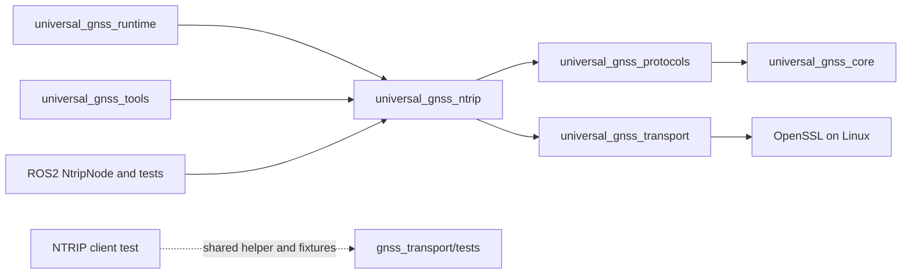

# Lot 5C — Atomic NTRIP relocation

Base: `94b80e2bdabb33b34fba62a126a7a5d6a20d3060`, verified merge of PR 17
into `origin/dev`. Branch: `refactor/move-gnss-ntrip`. Only `gnss_ntrip/` moves
to `core/gnss_ntrip/`; UG functional versioning remains independent.

The final local commit is the commit introducing this report, titled
`refactor(repo): relocate GNSS NTRIP without behavior changes`. Resolve its
full SHA without embedding a self-referential commit hash in its own contents:

```bash
git log -1 --diff-filter=A --format='%H %s' -- tools/branches/NTRIP_MOVE.md
```

## Pre-edit audit

The audit completed on the clean merge base before any file edit. NTRIP has
32 tracked files, subtree `706a586b7a7bc41c8145663b51a1be0f7f60d49f`.

| Consumer / surface | Current contract and source references | Required treatment |
| --- | --- | --- |
| Native root | `add_subdirectory(gnss_ntrip)` | Update only source directory |
| NTRIP CMake | C++17; PUBLIC protocols and transport; nine native tests, local caster conditional on Linux | Preserve every byte; no timeout, TLS or compilation policy changes |
| Transitive dependency | Protocols links core; Linux transport links OpenSSL | Preserve dependency graph and feature macros |
| ROS2 NtripNode and tests | Reconstruct NTRIP using `${UNIVERSAL_GNSS_SOURCE_ROOT}/gnss_ntrip`; link the public target | Change source only; retain `${CMAKE_CURRENT_BINARY_DIR}/gnss_ntrip`, packages, parameters and exports |
| Runtime and tools | Link `universal_gnss_ntrip`; include `universal_gnss_ntrip/...` | No source-directory dependency to update |
| NTRIP TLS regression | Root-relative `${CMAKE_SOURCE_DIR}/gnss_transport/tests` and `/fixtures/tls` | Leave helper/fixtures and the component CMake unchanged |
| Docker, Compose, CI and MAVROS | Root COPY / package colcon entry points; public node/executable/parameter identifiers | No physical NTRIP path adjustment needed |
| Formatter | Owned root `gnss_ntrip` | Select `core/gnss_ntrip`; same owned files |
| Manifest | Component selector and audited reference owner `gnss_ntrip/CMakeLists.txt` | Move those paths, keep shared reference destination unchanged |
| Current documentation | Root README, refactor status and distribution component table | Update active source locations only |

Dependency arrows mean **depends on**:



The test fixture directory is owned by transport, not NTRIP. Its path is rooted
at `CMAKE_SOURCE_DIR`, so moving NTRIP does not require changing that CMake or
moving fixtures. Native runtime's separate references remain valid. Isolated
ROS2 builds use the existing package-based entry points and exclude runtime.

## Integrity guards for computed TLS inputs

The audit deterministically removed `ca.crt` from an in-memory source snapshot.
The prior directory-level reference still allowed planning, because other files
remained in that directory and the fixture filename is computed at runtime.

Retain the directory-level edge (including the helper), and add three explicit
audited edges from the relocated NTRIP client test to the existing transport
fixtures `ca.crt`, `server.crt` and `server.key`. The test sets its CA file;
`tls_loopback_server.hpp` loads the server certificate and key. The files remain
owned by transport and unchanged. No component dependency, option, exclusion,
platform, public contract or generator implementation changes.

The real-repository generator tests now assert NTRIP header/source presence,
old-root absence and the four TLS inputs in all eight configurations. New fault
tests reject a missing relocated component, an injected legacy root and each
missing TLS helper/certificate/key. The existing unclassified sibling under
`core/` test remains active. These guards strengthen verification without
changing network behavior or weakening any previous rule.

## Public contracts and history

Preserve `universal_gnss_ntrip`, `universal_gnss_ntrip/...`, target names and
exports. The native archive remains `lib/libuniversal_gnss_ntrip.a` for the
existing default static Release configuration. Installed paths, executable names,
ROS2/ROSIDL, parameters, launch files and credentials handling are unchanged.

No changes to clients/casters, TLS negotiation, timeouts, reconnect policies,
GGA freshness/cadence, RTCM integrity, counters, diagnostics, cancellation or
shutdown. All 32 component files, including its tests and CMake, travel unchanged.

Root audits, ROS2 audits, validation reports/scripts, shared checkpoints and
the preceding relocation reports retain their recorded paths and bytes. Resolve
historical paths against their recorded commits, for example:

```bash
git show 94b80e2bdabb33b34fba62a126a7a5d6a20d3060:gnss_ntrip/src/ntrip_client.cpp
```

This source-only move does not affect downstream robot contracts. TODO/ROADMAP
functional counters and hardware gates remain unchanged; structural status is
tracked in `TODO_REPO_REFACTOR.md`. Runtime's existing formatting debt remains
outside scope. Transport and runtime require separate future audits and commits.

## Exact relocated files

Every path below moves from `gnss_ntrip/` to `core/gnss_ntrip/` with the same
relative name, blob and Git mode:

```text
CMakeLists.txt
include/universal_gnss_ntrip/gga_generator.hpp
include/universal_gnss_ntrip/gga_injection_policy.hpp
include/universal_gnss_ntrip/gga_injector.hpp
include/universal_gnss_ntrip/gga_sentence_builder.hpp
include/universal_gnss_ntrip/local_rtcm_caster.hpp
include/universal_gnss_ntrip/ntrip_caster_orchestrator.hpp
include/universal_gnss_ntrip/ntrip_client.hpp
include/universal_gnss_ntrip/ntrip_config.hpp
include/universal_gnss_ntrip/ntrip_correction_arrival_age.hpp
include/universal_gnss_ntrip/ntrip_metrics.hpp
include/universal_gnss_ntrip/ntrip_reconnect_policy.hpp
include/universal_gnss_ntrip/ntrip_request.hpp
include/universal_gnss_ntrip/ntrip_sourcetable.hpp
src/gga_generator.cpp
src/gga_injector.cpp
src/gga_sentence_builder.cpp
src/local_rtcm_caster.cpp
src/ntrip_caster_orchestrator.cpp
src/ntrip_client.cpp
src/ntrip_reconnect_policy.cpp
src/ntrip_request.cpp
src/ntrip_sourcetable.cpp
tests/test_gga_generator.cpp
tests/test_gga_injector.cpp
tests/test_gga_sentence_builder.cpp
tests/test_local_rtcm_caster.cpp
tests/test_ntrip_caster_orchestrator.cpp
tests/test_ntrip_client.cpp
tests/test_ntrip_foundation.cpp
tests/test_ntrip_reconnect_policy.cpp
tests/test_ntrip_sourcetable.cpp
```

## Validation

Results on 2026-11-09:

| Check | Result |
| --- | --- |
| Relocation identity | 32 exact renames, identical blobs/modes and subtree `706a586b7a7bc41c8145663b51a1be0f7f60d49f`; original root absent |
| Native Release configure / compile / install | PASS |
| Native installation compared with PR 17 base | All 33 files byte-identical, paths and full permission modes identical, including the NTRIP archive and existing executables |
| Targeted NTRIP CTest | 9/9 PASS |
| Full native CTest | 68/68 PASS |
| Existing Python tooling suite | 55/55 PASS |
| Generator and CI/policy suite | 78/78 PASS (49 generator/integration + 29 CI/policy) |
| Eight Kilted/Lyrical option combinations | Generation, source integrity and reproducibility PASS |
| Payload comparison with base, all eight configurations | Same selected components and every source byte/mode after only NTRIP path translation and the ROS2 source-reference line |
| Isolated Kilted | Build PASS; 165 tests, no errors/failures/skips |
| Isolated Lyrical | Build PASS; 166 tests, no errors/failures/skips |
| Isolated Lyrical + MAVROS | Build PASS; 168 tests, no errors/failures/skips |
| Formatting | Direct clang-format-21 check of 31 moved C/C++ files and global owned-file selection PASS |
| Syntax / links / active paths / Docker inputs | PASS |
| Dashboard / checkpoints / historical campaign checker / diff whitespace | PASS; counters, historical sources/data and shared checkpoints unchanged |

The comparison installation comes from lot 5B's validated Release build. Its
input `13dda0bb3f8504bf976ce48a68aec70e3dfd1b97` has exactly the same Git root
tree as the PR 17 merge base. All old artifacts remain untouched during the
byte/mode/path comparison; native CMake is freshly configured and built here.

The generator uses committed objects. A disposable local repository captured
the staged source candidate as commit
`63c744d76715d2e87331c649e6949175138e0be4`, root tree
`6dd2b3a1eb27d34d45aad3652b5ed83eb0e49658`. It supplied generation and isolated
build inputs. Only this excluded report changes afterward. Regeneration from
the final local commit verifies the same source inventories and manifest hash;
metadata retains each generation's exact source commit.

Manifest SHA-256: `2dae2b2b181d80505b157d964970fab53800722f43b23e84da07b2593b3bfa4f`.
Source inventory SHA-256 values are shared by both ROS2 profiles:

| Options | Inventory SHA-256 |
| --- | --- |
| Default | `c6b85655dc19710dc4597a4430f460a6d473bd05db188082f06bf4c1f8dab15f` |
| MAVROS | `7fa39d7b08775387dd023ccb066e44312ff4341caea37113facf6e57cc01793b` |
| Docker | `95103cbde6f25c2767f26f60ba68fbeca04ec307638abcde8ca908a1172b708f` |
| MAVROS+Docker | `595a604f27de85ab5ef6ff2a5da73a74d05987a75004eadca788fae262794643` |

All builds/tests/generation run as the normal project user, UID 1000. The
unchanged isolated runner streams only generated trees into containers, without
network, source mounts or inherited UG overlays. Dependency images are reused;
their exact identities match the [lot 3 validation record](CI.md).

Relevant commands:

```bash
cmake -S . -B /tmp/ug-lot5c-native -DCMAKE_BUILD_TYPE=Release
cmake --build /tmp/ug-lot5c-native --parallel 4
ctest --test-dir /tmp/ug-lot5c-native -R '^gnss_ntrip_' --output-on-failure
ctest --test-dir /tmp/ug-lot5c-native --output-on-failure
cmake --install /tmp/ug-lot5c-native --prefix /tmp/ug-lot5c-native-install
PYTHONDONTWRITEBYTECODE=1 python3 -m unittest discover -s scripts/tests -v
PYTHONDONTWRITEBYTECODE=1 python3 -m unittest discover -s tools/branches/tests -v
```

The generator suite runs against the immutable candidate before the local
work-branch commit. The eight generations use the existing workflow step with
that explicit source SHA. Each isolated run uses `validate_ci.py --build-image`,
making compilation and tests mandatory. The generated trees retain all required
transport TLS inputs without importing excluded runtime or host sources.

Not executed: Kilted+MAVROS compilation, ARM, production Docker image builds,
dependency image provisioning, physical receiver/caster deployments, Humble,
ESP32, GUI, BlueOS, remote GitHub Actions or publisher/protection trials.
No software PASS qualifies hardware or real network deployments. Existing
runtime formatting debt remains untouched and is not qualified by the unchanged
global formatter selection.

## Accompaniment and following lots

Outside the 32 renamed files, only these nine files change:

```text
CMakeLists.txt
README.md
TODO_REPO_REFACTOR.md
gnss_ros2/CMakeLists.txt
scripts/clang_format_21.sh
tools/branches/NTRIP_MOVE.md (new)
tools/branches/README.md
tools/branches/manifest.yaml
tools/branches/tests/test_distribution.py
```

Transport, runtime, driver, core, protocols, tools, ROS2 implementation/ROSIDL,
Docker/Compose, workflows, generator implementation, versions and historical
evidence remain unchanged. When transport is moved in a later lot, re-audit
NTRIP/runtime CMake helper paths and all manifest TLS-reference destinations
together. No other move, push, PR, tag, Release or distribution publication is
included in this local lot.
