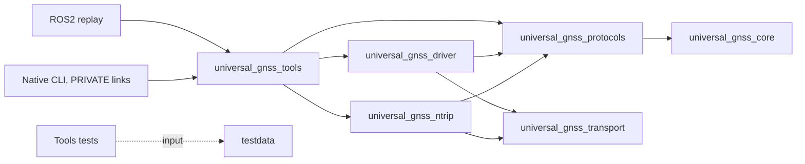

# Lot 7 — Atomic GNSS tools relocation

Base: `806b5831a6a947790196eac27ec9b7c753ea9dca`, verified merge of PR 20
at `origin/dev`. Branch: `refactor/move-gnss-tools`.

Only `gnss_tools/` moves to `tools/gnss_tools/`. The final local commit is the
commit adding this report, titled
`refactor(repo): relocate GNSS tools without behavior changes`:

```bash
git log -1 --diff-filter=A --format='%H %s' -- tools/branches/TOOLS_MOVE.md
```

## Pre-edit audit and feasibility

The audit completed before moving or editing project files. The clean expected
base contains **50 tracked files**, all mode `100644`: one CMakeLists, 12 public
headers, 24 implementation/CLI sources, 12 test sources and one test helper.
The complete original Git subtree is
`82b178a121b8369dcb1f4de09925e964b2c90209`.

The exact relative inventory, blobs and modes can be inspected without relying
on this description:

```bash
git ls-tree -r 806b5831a6a947790196eac27ec9b7c753ea9dca:gnss_tools
git ls-tree -r HEAD:tools/gnss_tools
```

| Surface | Audit finding | Treatment |
| --- | --- | --- |
| Library | `universal_gnss_tools`, C++17, PUBLIC driver/NTRIP/protocols | Preserve target, dependencies and every byte of internal CMake |
| Transitive dependencies | Transport through driver/NTRIP; common model through protocols; OpenSSL through Linux transport | No new edge or visibility change |
| Native CLI | Eight unconditional targets and four Linux targets; PRIVATE library links | Preserve names, arguments, return codes, output formats and installed commands |
| Native tests | Twelve tests; seven compile definitions use `${PROJECT_SOURCE_DIR}/testdata` | Repository project root remains unchanged; do not edit test source/helper or CMake |
| Internal paths | CURRENT_SOURCE include path, relative src/tests/include install paths | Remain valid after atomic move |
| ROS2 | Replay links tools; embedded build reconstructs it from the source root with native tests disabled | Change only tools source directory; preserve binary directory `gnss_tools` |
| Root CMake | `add_subdirectory(gnss_tools)` | Change only source directory |
| Formatter | Explicit owned component root | Replace root with `tools/gnss_tools`; same 49 C/C++ files and unchanged policy |
| Generator | Explicit tools selector; two audited cross-directory references | Translate these three paths, preserve 13 components, graph and options |
| Generator namespace | `tools/branches/` is separately excluded, not part of tools library ownership | No broad `tools/` selector; retain exclusions |
| Docker/Compose/CI/support scripts | Package-based ROS2 builds and installed CLI names; no active physical tools source path | No workflow, Dockerfile, Compose or support-script edit |
| Current docs | Root structure, refactor plan, distribution table, fixture provenance, current auto-config source pointers and NTRIP CLI pointer | Adapt only current source locations |
| Historical material | Audits, campaign scripts, prior MOVE reports, shared checkpoints and old auto-config proposed-file set | Preserve original paths and contents |

There is no internal fixture-path blocker. No external consumer of the physical
source root was found beyond the repository's ROS2 reconstruction; this audit
cannot enumerate private downstream consumers. Public includes and installed
commands do not acquire a new prefix.

## Dependencies and public contracts

Arrows mean dependency; edges between the native libraries are PUBLIC:



Preserve the public `universal_gnss_tools/...` headers, library name, CMake target,
install destinations and all 12 native CLI targets:

```text
rtcm_inspect gnss_inspect gnss_replay gnss_quality_report gnss_compare
gnss_export gnss_profile_preview gnss_config_plan gnss_discover
gnss_config_apply gnss_serial_monitor gnss_ntrip_monitor
```

The last four remain Linux-only. No parsing, configuration/write policy,
precision, timing, diagnostics, session semantics, profile, replay, export,
protocol, ROS2 interface, launch or parameter changes belong to this move.
Existing native installation limitations remain outside scope: the installed
headers/libraries are not a newly qualified standalone CMake SDK.

## Manifest and negative guards

The selector is exactly `tools/gnss_tools/`. `tools/branches/` remains excluded;
no other neighboring tool or script is implicitly owned. Both ROS2 profiles,
MAVROS/Docker options, package entry points, exclusions and transitive component
closure remain unchanged. Native runtime remains excluded at both old and new
paths. Existing TLS references and tests remain intact.

During the pre-edit audit, removing
`testdata/mixed/nmea_ubx_rtcm_unicore.bin` from an in-memory snapshot still allowed
the original generator to plan a distribution. Its existing directory-level
reference could not detect this computed individual test input. This is the
concrete reason for adding seven explicit audited fixture edges, using the
existing reference mechanism, without changing the generator algorithm:

```text
testdata/mixed/nmea_ubx_rtcm_unicore.bin
testdata/nmea/basic_fix.nmea
testdata/rtcm/basic_msm.rtcm
testdata/comparison/receiver_a.nmea
testdata/comparison/receiver_b.nmea
testdata/ubx/nav_pvt_sat_monrf.ubx
testdata/unicore/basic_ascii.log
```

These are existing inputs read through `TESTDATA_DIR` and `ReadBinaryFile` by
replay, inspection, comparison, export and discovery tests. No new dependency,
fixture content or production behavior is introduced. Each edge names an
existing consuming test source; removing any fixture must now fail planning.

Five real-manifest negative tests protect missing tools, the legacy root, an
unclassified tools sibling, generator script injection and individual missing
fixtures. Synthetic fixture paths and CI mutation checks follow the new
location. Eight-configuration integration assertions reject old tools paths,
generator leakage and development scripts, while allowing only the pre-existing
healthcheck test and optional support collector.

## Validation

Results on 2026-11-09, as normal user UID 1000:

| Check | Result |
| --- | --- |
| Git relocation | 50 R100; exact blobs, modes and subtree `82b178a121b8369dcb1f4de09925e964b2c90209`; legacy root absent |
| Fresh native Release configure/build/install | PASS |
| Targeted tools CTest selection | 12/12 PASS, including fixture replay, configuration and export tests |
| Complete native CTest | 68/68 PASS |
| Existing Python tooling tests | 55/55 PASS |
| Generator and CI/policy tests | 90/90 PASS: 61 generator/integration + 29 CI/policy |
| Installed files vs PR 20 base | 33/33 identical bytes, paths and full permissions |
| CLI help comparison | All 12 installed tools return 0, identical text after normalizing argv[0] |
| Offline CLI output comparison | Replay, mixed inspection, RTCM inspection, Unicore config-plan and profile-preview return 0 with identical stdout/stderr |
| Eight generated trees | Integrity, reproducibility and source-inventory conservation PASS |
| Explicit isolation boundaries | Old tools root, generator directory, native runtime, agent/CI/development directories absent in all eight outputs |
| Kilted isolated | Build PASS; 165 tests, zero errors/failures/skips |
| Lyrical isolated | Build PASS; 166 tests, zero errors/failures/skips |
| Lyrical with MAVROS isolated | Build PASS; 168 tests, zero errors/failures/skips |
| clang-format-21 | All 49 relocated C/C++ files and full existing owned-root selection PASS; no apply operation |
| Syntax, active source references and current links | PASS; historical paths classified separately |
| Docker COPY inputs and packaging references | PASS via generator and existing contract tests; production files unchanged |
| Dashboard/shared checkpoints | PASS; 10 indexed entries, zero problems/warnings; functional counters unchanged |
| Frozen evidence identity and diff whitespace | PASS |
| Direct runtime formatter audit | Raw exit 1, same 28 pre-existing diagnostics; NOT PASS |
| Historical campaign checker | Raw exit 1, same three transport fixture-key alerts; NOT PASS |
| Docker Compose | `docker compose version` returns 1: plugin absent; configuration CLI NOT EXECUTED |

The native comparison installation `/tmp/ug-lot6-install` was built from the
exact PR 20 source tree during the consolidation audit. This lot uses a fresh
Release build `/tmp/ug-lot7-native` and installation `/tmp/ug-lot7-install`.
Reference artifacts are unchanged. CLI checks are offline; live tools are only
invoked with `--help`, which returns before hardware enumeration or connections.
Configuration-application tests use deterministic fake transports and PTYs.
No physical receiver is accessed or configured.

### Immutable validation input

Generation and isolated builds use the committed candidate
`eb8aaa2f1bb676a92c10e59574aa2feb1c31c236` in a disposable local repository,
root tree `b95a3283faa2b1902eec07c29415e710fbc745e9`. Only this excluded report
changes after that snapshot. Final local commit generation must reproduce its
manifest/source inventory hashes; this report identifies the final commit by
the Git command above rather than embedding a self-referential SHA.

All isolated runners stream only generated sources into the pre-existing cached
dependency images, with no network, repository mount or inherited UG overlay:

- Kilted: `sha256:0eb6163dd3943411718e8355430a319b86d1baca11d84a0930ef81b73e7ce8cf`.
- Lyrical: `sha256:2c2b6e77472c03a522de6442344aac64ad9a1df1723fd7b506e6a346627f9029`.
- Lyrical/MAVROS: `sha256:8404b5a397f5eeeb98d673184cfc9748324a80672bf18086914aa71cafba12af`.

No image is provisioned or pulled. These builds test software integration,
not hardware operation.

### Eight distributions and conservation

For each profile, default/MAVROS/Docker/both still select 11/12/12/13 components
and contain 312/322/320/330 total files respectively. These include the four
generated metadata/instruction files. Compared with the base, copied sources
retain the same selection, relative paths after tools translation and modes.
Every implementation byte is preserved. Only the external ROS2 CMake source
path and two fixture README pointers change inside the copied payload.
The ROS2 binary directory remains `gnss_tools`; only its source path changes.
An initial comparison helper translated that binary directory too; correcting
the comparison to source-only translation required no project change.

All eight outputs were generated twice and inspected on disk. Only the existing
healthcheck test under `scripts/` is present by default; the Docker option also
retains the existing support collector. Generator scripts and other development
scripts remain excluded. Transport TLS inputs remain present.

Manifest SHA-256: `d0c29b1ee9836be5b19aa2f3fb7499a53dcf6b390601eff6622469abfba0123b`.
The following source inventory hashes apply to both ROS2 profiles:

| Options | Inventory SHA-256 |
| --- | --- |
| Default | `a39df0fb942ab2e8ea107645d832cc0a8305771d4873483c232c48f7bd5aea55` |
| MAVROS | `87eecafb57be2d2e3e5a41014dda977f93e212a3548e4911ff58f74741fd9e77` |
| Docker | `6d39f4a3f696f78a8af45ba4b7cefdcc6a724322488879969c3b193b4f99f35a` |
| MAVROS+Docker | `3cd1dca957d142beee626fe009153d39010fb97ad1740d6d4474ee1ab794b2c3` |

Relevant validation commands:

```bash
cmake -S . -B /tmp/ug-lot7-native -DCMAKE_BUILD_TYPE=Release
cmake --build /tmp/ug-lot7-native --parallel 4
ctest --test-dir /tmp/ug-lot7-native -R '^gnss_tools_' --output-on-failure
ctest --test-dir /tmp/ug-lot7-native --output-on-failure
cmake --install /tmp/ug-lot7-native --prefix /tmp/ug-lot7-install
PYTHONDONTWRITEBYTECODE=1 python3 -m unittest discover -s scripts/tests -v
PYTHONDONTWRITEBYTECODE=1 python3 -m unittest discover -s tools/branches/tests -v
bash scripts/clang_format_21.sh --check --all
```

Generator tests run from the immutable candidate repository before the final
work-branch commit. Isolated builds use `validate_ci.py --source-ref <SHA>
--distribution <profile> --build-image <cached-image>`; MAVROS adds `--with mavros`.


## Raw non-green checks and limits

The baseline historical checker returns **1**, with exactly three alerts for
transport test fixtures `ca.key`, `client.key` and `server.key`; before editing,
it examined 272 candidate files and 145 relative Markdown targets. After the move
and current documentation updates, it examines 324 files and 148 targets,
with exactly the same three failures and frozen SVG identity. The scanner,
keys, security rules and historical evidence remain unchanged. No result with
these alerts is called PASS. Existing workflows syntax-compile the scanner but
do not execute it; the historical manual publication procedure does execute it.

The runtime serial factory retains its **28 pre-existing clang-format-21
diagnostics** outside the current formatter's selected roots. Only the tools
root is translated; no runtime inclusion/exclusion, formatter-policy change or
formatting apply operation is authorized.

Docker Compose was absent at the consolidation audit. Record an unavailable
Compose CLI as a limitation, never as successful configuration validation.
No hardware GNSS, live receiver configuration or external caster access is
required. No change to functional TODO/ROADMAP progress, versions, historical
reports, publication workflows, SDK contract or downstream robot behavior.

No push, PR, merge, tag, Release or remote distribution publication is performed.

## Residual limitations and final scope

Not executed: Compose configuration CLI, production Docker image builds, new
dependency image provisioning, Kilted+MAVROS, non-Linux/ARM qualification,
physical GNSS/serial qualification, external caster/network qualification,
Humble, ESP32, GUI, BlueOS, remote GitHub Actions or publication/protection trials.
No native SDK packaging defect is fixed here. The known runtime format debt,
scanner nonzero result and historical relative links remain explicit.

Only these 13 accompaniment files change outside the exact renamed subtree:

```text
CMakeLists.txt
README.md
TODO_REPO_REFACTOR.md
docs/auto_configuration.md (current Audit Summary source paths only)
docs/ntrip.md
gnss_ros2/CMakeLists.txt
scripts/clang_format_21.sh
testdata/README.md
tools/branches/README.md
tools/branches/TOOLS_MOVE.md (new)
tools/branches/manifest.yaml
tools/branches/tests/test_ci.py
tools/branches/tests/test_distribution.py
```

The historical proposed-file section of the mixed auto-configuration design,
all prior relocation reports, validation campaigns/scripts, audits and shared
checkpoints remain unchanged. Current documentation only points to the new
source locations; no functional TODO/ROADMAP accounting changes.

Complete renamed inventory (prefix `gnss_tools/` becomes `tools/gnss_tools/`):

```text
CMakeLists.txt
include/universal_gnss_tools/config_apply.hpp
include/universal_gnss_tools/config_plan.hpp
include/universal_gnss_tools/gnss_log_comparison.hpp
include/universal_gnss_tools/gnss_quality_report.hpp
include/universal_gnss_tools/gnss_replay.hpp
include/universal_gnss_tools/gnss_stream_inspector.hpp
include/universal_gnss_tools/ntrip_monitor.hpp
include/universal_gnss_tools/profile_preview.hpp
include/universal_gnss_tools/receiver_discovery_format.hpp
include/universal_gnss_tools/rtcm_inspector.hpp
include/universal_gnss_tools/runtime_export.hpp
include/universal_gnss_tools/runtime_state_format.hpp
src/config_apply.cpp
src/config_plan.cpp
src/gnss_compare.cpp
src/gnss_config_apply.cpp
src/gnss_config_plan.cpp
src/gnss_discover.cpp
src/gnss_export.cpp
src/gnss_inspect.cpp
src/gnss_log_comparison.cpp
src/gnss_ntrip_monitor.cpp
src/gnss_profile_preview.cpp
src/gnss_quality_report.cpp
src/gnss_quality_report_cli.cpp
src/gnss_replay.cpp
src/gnss_replay_cli.cpp
src/gnss_serial_monitor.cpp
src/gnss_stream_inspector.cpp
src/ntrip_monitor.cpp
src/profile_preview.cpp
src/receiver_discovery_format.cpp
src/rtcm_inspect.cpp
src/rtcm_inspector.cpp
src/runtime_export.cpp
src/runtime_state_format.cpp
tests/test_config_apply.cpp
tests/test_config_plan.cpp
tests/test_gnss_log_comparison.cpp
tests/test_gnss_quality_report.cpp
tests/test_gnss_replay.cpp
tests/test_gnss_stream_inspector.cpp
tests/test_ntrip_monitor.cpp
tests/test_profile_preview.cpp
tests/test_receiver_discovery_format.cpp
tests/test_rtcm_inspector.cpp
tests/test_runtime_export.cpp
tests/test_runtime_state_format.cpp
tests/testdata_utils.hpp
```
