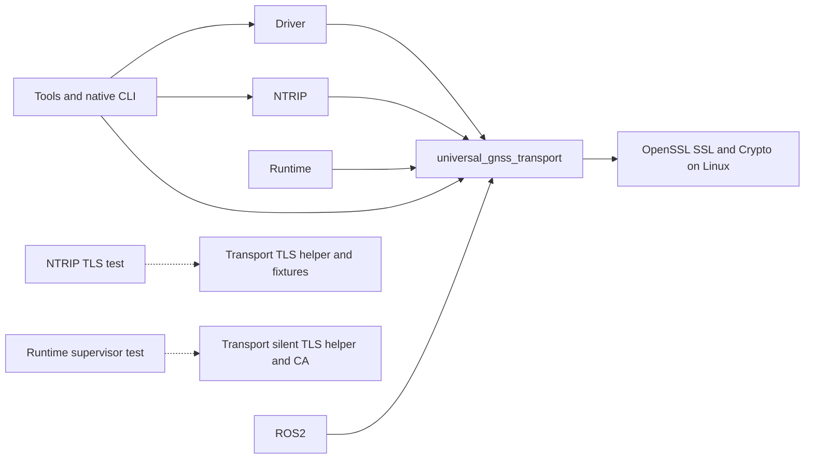

# Lot 5D — Atomic transport relocation

Base: `933ff8c3dd1c883dc1f3b2662051b16c0c847159`, verified merge of PR 18
into `origin/dev`. Branch: `refactor/move-gnss-transport`. Only
`gnss_transport/` moves to `core/gnss_transport/`; no functional version change.

The final local commit is the commit introducing this report, titled
`refactor(repo): relocate GNSS transport without behavior changes`. Resolve its
full SHA with:

```bash
git log -1 --diff-filter=A --format='%H %s' -- tools/branches/TRANSPORT_MOVE.md
```

## Pre-edit inventory and feasibility

The audit completed on the clean expected base before file edits. It counted
30 tracked files, all mode `100644`, with original subtree identity
`7602668817ff6c78d2c5d1f843f163469a142d99`.

| Active reference | Old source location / meaning | Required adjustment |
| --- | --- | --- |
| Root CMake | `add_subdirectory(gnss_transport)` | Select `core/gnss_transport` only |
| ROS2 CMake | `${UNIVERSAL_GNSS_SOURCE_ROOT}/gnss_transport` | Change source; retain `${CMAKE_CURRENT_BINARY_DIR}/gnss_transport` and all targets/exports |
| `core/gnss_ntrip/CMakeLists.txt` | `${CMAKE_SOURCE_DIR}/gnss_transport/tests` and `/tests/fixtures/tls` | Add `core/` in the helper include and fixture compile definition |
| `gnss_runtime/CMakeLists.txt` | Same two root-relative helper/fixture references | Same path-only adjustment, without moving runtime |
| Formatter | Owned root `gnss_transport` | Select `core/gnss_transport`; same owned files |
| Manifest component | `transport.paths = ["gnss_transport/"]` | Select only `core/gnss_transport/`, never all of `core/` |
| Manifest audited references | Four transport destinations: test directory plus `ca.crt`, `server.crt`, `server.key` | Add `core/` to destinations; preserve origins/reasons and all existing guards |
| Generator tests | Four NTRIP TLS input paths; real eight-configuration closure | Translate paths, assert moved transport/header/source/helpers and old-root absence; test missing component, legacy root and missing silent helper |
| Current docs | Root README, refactor status, distribution table, transport source pointer | Update current source locations; add this report |

Driver and tools link public targets/includes, not source folders. Tools also
link transport directly in several native CLI targets; its common library
obtains transport transitively through driver/NTRIP. MAVROS consumes existing
ROS2/common-model exports. Docker/Compose and GitHub workflows contain no active
transport source path: root COPY and package-based colcon entry points remain
valid. Public names, node parameters and executable identifiers are not paths
to rewrite.

The transport's own CMake uses `CMAKE_CURRENT_SOURCE_DIR` for includes and TLS
fixtures, with component-relative `src/` and `tests/` paths. Helpers use the
fixture macro rather than a fixed source-root location. This permits the exact
subtree move with **no modification inside the moved component**; no blocking
calculated path requires an identity exception.

## Dependencies, conditionals and shared fixtures



Production transport has no internal target dependency. Its C++17 target always
contains memory-stream and RTCM-writer sources. Linux adds POSIX serial, TCP
and UDP sources, OpenSSL SSL/Crypto, and the existing three public
`UNIVERSAL_GNSS_TRANSPORT_HAS_*` feature definitions. Four native transport tests
run on Linux; serial/TCP/UDP test selection, deadlines and macros are unchanged.
Other platforms retain their previous conditional source set.

All shared inputs move inside the same transport subtree:

- `tests/tls_loopback_server.hpp`: transport TCP and NTRIP client tests;
- `tests/silent_tls_loopback_server.hpp`: transport TCP and runtime supervisor;
- `tests/fixtures/tls/ca.crt`, `ca.key`, `client.cnf`, `client.crt`, `client.key`,
  `server.cnf`, `server.crt`, `server.key`.

The existing NTRIP regression checks each of the first helper, CA certificate,
server certificate and server key independently. Its three exact manifest
references remain mandatory at the new locations. The silent-helper guard also
rejects its individual deletion. Existing rejection of an unclassified sibling
under `core/` is retained; no global directory inclusion or generator algorithm
change is introduced. Component graph (13 components), closure, options,
eligibility and exclusions stay unchanged.

## Public contracts and history

Preserve target/library `universal_gnss_transport`, include namespace
`universal_gnss_transport/...`, install/export destinations and macros. The
native static archive remains `lib/libuniversal_gnss_transport.a`. Memory,
serial, TCP/UDP interfaces, network/TLS behavior, synchronization, timeouts,
cancellation/reconnect policies, certificate checks, GNSS semantics, ROS2 and
MAVROS interfaces, parameters, launch and ROSIDL are unchanged.

Only two consumer CMake files change their test-input paths; their C++ sources,
headers and tests do not change. Runtime stays at the root, with its existing
formatting debt untouched. No downstream robot behavior, hardware qualification
or functional progress credit follows from this structural move. Functional
TODO/ROADMAP counters remain unchanged; structural status is updated separately.

Root/ROS2 audits, validation reports/scripts, shared checkpoints and the previous
relocation reports retain their historical paths and bytes. For old references:

```bash
git show 933ff8c3dd1c883dc1f3b2662051b16c0c847159:gnss_transport/CMakeLists.txt
```

## Exact relocated files

The following relative paths move from `gnss_transport/` to
`core/gnss_transport/`, preserving their blobs and Git modes:

```text
CMakeLists.txt
include/universal_gnss_transport/byte_stream.hpp
include/universal_gnss_transport/memory_stream.hpp
include/universal_gnss_transport/posix_serial_transport.hpp
include/universal_gnss_transport/ring_buffer.hpp
include/universal_gnss_transport/rtcm_frame_writer.hpp
include/universal_gnss_transport/tcp_client_transport.hpp
include/universal_gnss_transport/transport_error.hpp
include/universal_gnss_transport/transport_metrics.hpp
include/universal_gnss_transport/transport_status.hpp
include/universal_gnss_transport/udp_client_transport.hpp
src/memory_stream.cpp
src/posix_serial_transport.cpp
src/rtcm_frame_writer.cpp
src/tcp_client_transport.cpp
src/udp_client_transport.cpp
tests/fixtures/tls/ca.crt
tests/fixtures/tls/ca.key
tests/fixtures/tls/client.cnf
tests/fixtures/tls/client.crt
tests/fixtures/tls/client.key
tests/fixtures/tls/server.cnf
tests/fixtures/tls/server.crt
tests/fixtures/tls/server.key
tests/silent_tls_loopback_server.hpp
tests/test_posix_serial_transport.cpp
tests/test_tcp_client_transport.cpp
tests/test_transport_foundation.cpp
tests/test_udp_client_transport.cpp
tests/tls_loopback_server.hpp
```

## Validation

Results on 2026-11-09:

| Check | Result |
| --- | --- |
| Relocation | 30 exact renames; identical blobs/Git modes and subtree `7602668817ff6c78d2c5d1f843f163469a142d99`; old root absent |
| Native Release configure / compile / install | PASS |
| Installation compared with PR 18 base | All 33 files byte-identical, with identical paths/full permissions, including transport archive and existing executables |
| Targeted transport CTest | 4/4 PASS |
| NTRIP client TLS CTest | 1/1 PASS |
| Runtime supervisor CTests | 2/2 PASS |
| Complete native CTest | 68/68 PASS |
| Existing Python tooling tests | 55/55 PASS |
| Generator and CI/policy tests | 81/81 PASS (52 generator/integration + 29 CI/policy) |
| Eight Kilted/Lyrical option combinations | Generation, integrity and reproducibility PASS |
| Payload comparison against base, eight configurations | Same selected components, source bytes and modes after transport path translation and the ROS2/NTRIP consumer CMake path edits |
| Isolated Kilted | Build PASS; 165 tests, no errors/failures/skips |
| Isolated Lyrical | Build PASS; 166 tests, no errors/failures/skips |
| Isolated Lyrical + MAVROS | Build PASS; 168 tests, no errors/failures/skips |
| Formatting | All 21 moved C/C++ files and global owned-file selection PASS with clang-format-21 |
| Shell/Python/manifest syntax, active paths and current links | PASS |
| Docker / Compose / COPY inputs | Unchanged sources; existing Python contract tests and optional Docker generation closures PASS |
| Dashboard / checkpoint audit / historical tree comparisons / diff whitespace | PASS; no functional counter, shared checkpoint or historical artifact changes |
| Frozen historical campaign checker | Raw exit 1 for exactly three fixture-key patterns; required review completed below, no other reported failure |

The reference installation is lot 5C's validated native Release output. Its input
commit `a6a71e464ca2072d5e3c130fd724527eb0895932` has exactly the same root
tree as the merge serving as this lot's base. Comparison does not rebuild or
alter the reference artifacts. Native transport/TLS/supervisor tests use local
software endpoints and PTYs, not physical receiver access.

## Historical-checker fixture-key review

The unchanged `scripts/validation/check_rc6_campaign_review.py` sees the moved
fixture files in its historical diff and reports these three paths:

```text
core/gnss_transport/tests/fixtures/tls/ca.key
core/gnss_transport/tests/fixtures/tls/client.key
core/gnss_transport/tests/fixtures/tls/server.key
```

Its raw exit code remains **1**, not PASS. All other link, campaign accounting,
artifact identity, JSON/SVG and rendering checks complete without another
reported failure. The three messages require a credential-pattern review; the
review established:

- Each key is the exact pre-existing tracked blob at the corresponding old
  path on `933ff8c3dd1c883dc1f3b2662051b16c0c847159`, with Git mode `100644`.
- The workspace files retain their non-executable `0600` permissions; no chmod
  or key regeneration is performed. Git-exported mode remains the same as the
  pre-move Git contract.
- OpenSSL-derived public keys match the respective versioned certificates.
  Subjects are `universal-gnss-test-ca`, `universal-gnss-test-client` and
  `localhost`, issued by the test CA.
- The TLS helper consumes these fixture paths and binds `INADDR_LOOPBACK`.
  The native transport, NTRIP and runtime regressions pass with those inputs.

No new key content is introduced. The raw scanner result is retained and
documented separately from this review. No historical checker, evidence file,
secret-pattern rule, workflow or CI exception is changed to suppress it.

## Immutable source and reproducibility

The generator consumes committed objects. A disposable local Git repository
captures the staged candidate as commit
`69ddc1f6bebb37dc7c7a05cb35157d3b7bc86bb0`, root tree
`8b1fbd488c1d66fa32d0e13b289c0cb33fb06046`. This commit supplies the eight
generation runs and all three isolated builds. Only this excluded report changes
afterward; final-commit regeneration checks identical source inventories and
manifest hash against the tested inputs.

Manifest SHA-256: `7254ce6b894820f8e64ec41ae26104c0c312f51e18fa64817b78502a5ec4a0e4`.
The two ROS2 profiles share these inventory SHA-256 values:

| Options | Inventory SHA-256 |
| --- | --- |
| Default | `e819b0f586c24022766dcd3cc9abb0835ad365206d638954e24ad8f73e40cb20` |
| MAVROS | `729b22688b235fbb75708c996dbdade4463503ab1a98ca53480d5e07dd7ae74a` |
| Docker | `41a6c1b5e4887c2d1283a41aeb0b762834acfb270e3fcdd617c304e3188e1567` |
| MAVROS+Docker | `bb628b1e9cfdd5c3dc558931d19ced196454b75463f68bf5a10dea7f55824376` |

All project builds/tests/generation run as the normal user, UID 1000. The
unchanged isolated runner streams only generated trees into containers, without
network or source mounts and with a cleared environment. The three reused
dependency image identities match the [lot 3 validation record](CI.md); image
provisioning is not repeated. No excluded runtime or host source is available
to the isolated ROS2 builds.

Relevant native commands:

```bash
cmake -S . -B /tmp/ug-lot5d-native -DCMAKE_BUILD_TYPE=Release
cmake --build /tmp/ug-lot5d-native --parallel 4
ctest --test-dir /tmp/ug-lot5d-native -R '^gnss_transport_' --output-on-failure
ctest --test-dir /tmp/ug-lot5d-native -R '^gnss_ntrip_test_ntrip_client$' --output-on-failure
ctest --test-dir /tmp/ug-lot5d-native -R '^gnss_runtime_' --output-on-failure
ctest --test-dir /tmp/ug-lot5d-native --output-on-failure
cmake --install /tmp/ug-lot5d-native --prefix /tmp/ug-lot5d-native-install
PYTHONDONTWRITEBYTECODE=1 python3 -m unittest discover -s scripts/tests -v
PYTHONDONTWRITEBYTECODE=1 python3 -m unittest discover -s tools/branches/tests -v
```

The generator suite uses the immutable candidate before the local commit. Eight
combinations execute the existing workflow generation step with the explicit
source SHA; isolated runs use `validate_ci.py --build-image`, requiring both
compilation and tests. These checks do not depend on excluded source files.

Not executed: Kilted+MAVROS compilation, non-Linux/ARM validation, production
Docker image builds, dependency image provisioning, physical serial/receiver or
remote network qualification, Humble, ESP32, GUI, BlueOS, remote GitHub Actions,
publisher/protection trials or publication. Runtime formatting debt remains
outside the unchanged global formatter selection. No hardware result is inferred.

## Exact accompaniment scope

Outside the 30 renamed files, only these twelve files change:

```text
CMakeLists.txt
README.md
TODO_REPO_REFACTOR.md
core/gnss_ntrip/CMakeLists.txt
docs/transport.md
gnss_ros2/CMakeLists.txt
gnss_runtime/CMakeLists.txt
scripts/clang_format_21.sh
tools/branches/README.md
tools/branches/TRANSPORT_MOVE.md (new)
tools/branches/manifest.yaml
tools/branches/tests/test_distribution.py
```

There is one local work-branch commit. No other component move, functional
change, version change, historical evidence edit, publication workflow change,
push, PR, tag, Release or distribution publication belongs to this lot.
Runtime requires a separate re-audit before its eventual atomic move.
